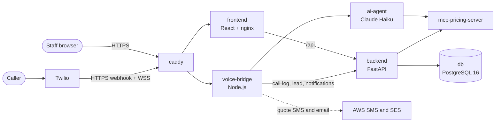

# Renovo Cape AI receptionist

[](https://github.com/YandaTech/INSY7315-Renovo/actions/workflows/ci-cd.yml)
[](https://github.com/YandaTech/INSY7315-Renovo/actions/workflows/uptime.yml)
[](https://app.16-192-12-251.sslip.io)

An AI phone receptionist for Renovo Cape, a Cape Town business that
resurfaces and restores baths, sinks, tiles, cupboards and counter-tops. A
caller rings the Twilio number and a Claude Haiku agent takes the job
details, prices the job with Renovo's own pricing rules and gives an
estimate. When the call ends, the call log, transcript and lead appear in a
staff dashboard, and the caller gets the quote by SMS (and by email if they
gave an address). Staff follow up from the dashboard.

| Live | URL |
|---|---|
| Staff dashboard | https://app.16-192-12-251.sslip.io |
| API health | https://app.16-192-12-251.sslip.io/api/health |
| Voice webhook (Twilio only) | https://voice.16-192-12-251.sslip.io/voice (unsigned requests get 403) |

**Try it:** log in to the dashboard and open **Demo call**. It calls the AI
receptionist from the browser, and the call shows up as a lead on the
Dashboard page when you hang up. Public sign-up is closed; an admin creates
accounts on the **Staff** page.

## Architecture

Production runs 7 containers from `docker-compose.prod.yml` on one AWS EC2
server. Only Caddy publishes ports.



| Container | What it does |
|---|---|
| `caddy` | HTTPS for both hostnames (Let's Encrypt), security headers and CSP |
| `frontend` | React dashboard: leads, call logs, statistics, pricing, staff, audit log, demo call |
| `backend` | FastAPI: auth (httpOnly cookie, roles), calls, leads, notifications, audit log. Runs Alembic migrations on start |
| `db` | PostgreSQL 16, internal network only |
| `voice-bridge` | Twilio webhook and ConversationRelay WebSocket, quote SMS and email |
| `ai-agent` | Claude Haiku conversation loop with a `get_quote` tool |
| `mcp-pricing-server` | Quote calculation from `config/pricing_rules.json` |

## Tech stack

| Area | Tools |
|---|---|
| Frontend | React 19, TypeScript, Vite, Tailwind CSS, Twilio Voice SDK, Vitest |
| Backend | Python 3.12, FastAPI, SQLAlchemy, Alembic, PostgreSQL 16 (SQLite in local dev), pytest |
| Voice | Node.js 22, Express, `ws`, Twilio ConversationRelay, AWS End User Messaging (SMS), Amazon SES (email) |
| AI | Anthropic Claude Haiku (`anthropic` SDK), FastAPI pricing server |
| Hosting | AWS EC2 `t3.small` in `eu-north-1`, Docker Compose, Caddy, SSM (port 22 closed), CloudWatch Logs and alarm |
| CI/CD | GitHub Actions (8 jobs), GitHub Deployments, systemd timer pull deploy with health-check rollback |

## Quick start (local)

```
cp .env.example .env      # fill in ANTHROPIC_API_KEY at minimum
docker compose up --build
```

`docker-compose.yml` runs the 5 app services with hot reload, on SQLite.
Open http://localhost:5173, sign up (the first account becomes the admin)
and log in. In Docker, voice-bridge is on host port **5050** (macOS AirPlay
holds 5000).

`.env.example` lists every variable the services read: Twilio
(`TWILIO_ACCOUNT_SID`, `TWILIO_AUTH_TOKEN`, `TWILIO_API_KEY_SID`,
`TWILIO_API_KEY_SECRET`, `TWILIO_TWIML_APP_SID`, ...), `ANTHROPIC_API_KEY`,
`SECRET_KEY`, `SERVICE_API_KEY`, the SMS and email provider settings and the
service URLs. `.env` is gitignored; never commit it. Production uses
`.env.production.example` (see [deploy/README.md](deploy/README.md)).

### Test a call without a phone

With the stack running:

```
cd voice-bridge
PORT=5050 npm run simulate-call                    # scripted caller
PORT=5050 npm run simulate-call -- --interactive   # type the caller's lines
```

This plays Twilio's part over the WebSocket, so the call goes through the
agent and pricing server and ends up as a call log and lead in the
dashboard. The final hang-up logs a Twilio 401 because the call SID is fake.

### Test a real call against local

1. `ngrok http 5050`
2. In the Twilio console, set the number's voice webhook to
   `https://<ngrok-host>/voice` (HTTP POST). The number only needs Voice
   capability.
3. Call the number.

## Tests

CI runs all 5 suites (340 tests) and the 13 end-to-end tests on every push.
To run the suites locally, start from the repo root:

```
cd backend && SECRET_KEY=local-test-secret-at-least-32-chars python -m pytest   # 212 tests (47 need PostgreSQL, skipped locally)
cd frontend && npm ci && npm test                                               # 70 Vitest tests
cd voice-bridge && npm ci && npm test                                           # 43 node --test tests
cd mcp-pricing-server && python -m pytest tests                                 # 8 tests
cd ai-agent && python -m pytest tests                                           # 7 tests
```

Install each Python service's `requirements.txt` (plus `pytest`) first.
The PostgreSQL tests run when `TEST_POSTGRES_URL` points at a database.

## Quality

- **End-to-end tests.** [e2e/tests](e2e/tests) holds 13 Playwright tests
  that drive the dashboard in Chromium against the production images
  (nginx, FastAPI, PostgreSQL, pricing server) from
  [docker-compose.e2e.yml](docker-compose.e2e.yml). They cover the first
  sign-up, login and logout, roles, Log a call, leads, Statistics, the
  Audit log and password resets. The "End-to-end tests" job in
  [ci-cd.yml](.github/workflows/ci-cd.yml) runs them on every push and keeps
  the HTML report and traces as the `playwright-report` artifact. To run
  them locally, see the top of `docker-compose.e2e.yml`.
- **Performance.** [docs/quality/performance.md](docs/quality/performance.md)
  has Lighthouse scores (login page 99 to 100 in every category), latency
  of the live server and of the API on its own, and bundle sizes, with the
  raw outputs in [docs/quality/raw/](docs/quality/raw).

## Database migrations

The backend container runs `python -m app.migrate` before it starts, which
brings the database up to the latest Alembic migration. To change the schema,
edit the models, then from `backend/`:

```
alembic revision --autogenerate -m "describe the change"
alembic upgrade head
```

Check the generated file in `backend/alembic/versions/` before committing it.

## Deployment

`main` deploys to production automatically once CI passes on it. The server
checks `main` every 5 minutes. For a new commit it records a GitHub
Deployment, backs up the database, deploys into a fresh folder, and rolls back
if the health check fails. In other words, nobody logs in to the server to
ship a change: merging to `main` is the release.

- [docs/deployment-lifecycle.md](docs/deployment-lifecycle.md): the whole
  lifecycle from branch to monitoring, with rollback, secrets and metrics
- [deploy/README.md](deploy/README.md): server setup, commands, backups and
  monitoring

## Documentation

| Document | What it covers |
|---|---|
| [docs/final-report.md](docs/final-report.md) | Final project report, including the response to Task 2 feedback |
| [docs/deployment-lifecycle.md](docs/deployment-lifecycle.md) | CI/CD and deployment lifecycle |
| [deploy/README.md](deploy/README.md) | Hosting, deploy commands, backups, monitoring |
| [docs/security-design.md](docs/security-design.md) | Security and data design |
| [docs/security/report.md](docs/security/report.md) | Vulnerability scans, CVSS scores and retest |
| [docs/incident-response.md](docs/incident-response.md) | Incident response runbook |
| [docs/contributions.md](docs/contributions.md) | Team contributions from the git history |
| [CHANGELOG.md](CHANGELOG.md) | Release history |

## Team

YandaTech, INSY7315, 2026.

| Name | Student number | Role |
|---|---|---|
| Aliyu Yahaya Haliru | ST10440112 | Voice pipeline, hosting, CI/CD, security |
| Yaseera Khan | ST10456786 | Dashboard frontend |
| Nikita Correia Freire | ST10279031 | First voice-bridge service, notification log, SMS and email functions |
| Demira Yashwant Harry | ST10443785 | Original backend API, refactor into routers, repositories and services |
| Adam Benting | ST10440722 | Authentication, login rate limiting, CI |
