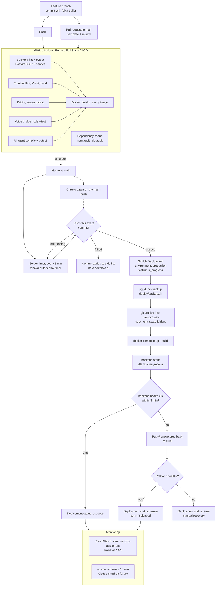

# Deployment lifecycle

This document follows one change from a branch to production, and then
shows how we watch it there. Each stage names the file that implements it,
what can go wrong, how we find out and how we recover.

Server set-up and the individual commands are in
[deploy/README.md](../deploy/README.md). Incidents are handled with
[incident-response.md](incident-response.md).

## Contents

1. [Lifecycle diagram](#1-lifecycle-diagram)
2. [Stage by stage](#2-stage-by-stage)
3. [Branching and pull requests](#3-branching-and-pull-requests)
4. [Environments](#4-environments)
5. [Configuration and secrets](#5-configuration-and-secrets)
6. [Database migrations](#6-database-migrations)
7. [Rollback](#7-rollback)
8. [Releases and versioning](#8-releases-and-versioning)
9. [Monitoring and alerting](#9-monitoring-and-alerting)
10. [Verifying a deploy](#10-verifying-a-deploy)
11. [Efficiency and delivery metrics](#11-efficiency-and-delivery-metrics)

## 1. Lifecycle diagram



**In plain terms:** nothing reaches production unless the same commit has
passed every CI job. The server pulls the change itself, so GitHub never
holds a key to the server. Every deploy starts with a database backup and
ends with a health check, and a failed health check puts the previous
version back on its own.

## 2. Stage by stage

| # | Stage | What happens | Implemented in | What can fail | How it is detected and recovered |
|---|---|---|---|---|---|
| 1 | Branch and commit | Work happens on a personal or feature branch. Each commit names its Ajiya ticket in an `Ajiya: <ID>` trailer | `AGENTS.md`, `ajiya/` | Commit without a ticket | `ajiya check` lists it; amend before pushing |
| 2 | Push CI | Every push to every branch runs the full workflow | `.github/workflows/ci-cd.yml` (`on: push: branches: "**"`) | Any job fails | Red run in Actions and on the commit; fix and push again |
| 3 | Pull request | A PR to `main` uses the template and runs CI again on the merge result | `.github/pull_request_template.md`, `ci-cd.yml` (`on: pull_request`) | CI red, missing test notes | Reviewer does not merge until the checks are green |
| 4 | CI jobs | 7 jobs start in parallel; Docker build waits for the 5 test jobs (`needs:`). The end-to-end job builds the stack from `docker-compose.e2e.yml` and runs 13 Playwright tests in Chromium | `ci-cd.yml` jobs 1 to 8 | Lint, test, build, browser test or audit failure | Job log in Actions. `npm audit` fails on high or critical; `pip-audit` fails on any known vulnerability |
| 5 | Merge to main | PR merged; GitHub pushes the merge commit to `main` and CI runs on it | GitHub | Broken merge result | CI on the `main` push; the deploy gate (stage 7) refuses it |
| 6 | Timer picks it up | `renovo-autodeploy.timer` runs the script 2 minutes after boot and every 5 minutes after the last run. The script fetches `main` into a bare clone `~/renovo-src.git` | `deploy/systemd/renovo-autodeploy.{timer,service}`, `deploy/autodeploy.sh` | GitHub unreachable, token expired or revoked | `curl` or `git fetch` fails, the unit ends `failed`; `journalctl -u renovo-autodeploy` shows it. Replace `~/.renovo-gh-token` |
| 7 | CI gate | The script asks the GitHub API for the `push` runs of the CI workflow on this exact SHA. Running: try again next tick. Passed: deploy. Anything else: log it and add the SHA to `~/.renovo-skipped` | `autodeploy.sh` ("Gate") | CI failed | The commit is never deployed. Push a fix; the new SHA goes through the gate. A failed run that is later re-run green stays skipped: deploy it with `--ref` |
| 8 | Deployment record | Creates a GitHub Deployment for the SHA in environment `production`, then posts status `in_progress` | `autodeploy.sh` (`api POST /deployments`) | API call fails | The script carries on without a record, and the journal still logs every step |
| 9 | Backup | `pg_dump` of the live database to `~/backups/renovo-<timestamp>.dump` before anything changes | `deploy/backup.sh` | Disk full, `db` down | `set -e` stops the deploy before any change; the live version keeps running. The GitHub record stays at `in_progress`, so check the journal |
| 10 | Fresh-folder deploy | `git archive` of the SHA into `~/renovo.new`, copy `~/renovo/.env*`, move `~/renovo` to `~/renovo.prev`, move the new folder into place | `autodeploy.sh` | Archive or copy fails | `set -e` stops; if it stops after the first move, `~/renovo.prev` holds the old tree (see section 7) |
| 11 | Build and start | `docker compose -f docker-compose.prod.yml up --build -d` | `autodeploy.sh`, `docker-compose.prod.yml` | Image build fails | Treated like a failed health check: rollback (stage 14) |
| 12 | Migrations | The backend container runs `python -m app.migrate` (Alembic `upgrade head`) before Uvicorn starts | `backend/Dockerfile` (`CMD`), `backend/app/migrate.py` | Migration error | Backend never becomes healthy, so stage 13 fails and rolls back. See section 6 for the database side |
| 13 | Health check | Up to 36 tries, 5 seconds apart (3 minutes), of `GET http://localhost:8000/health` inside the backend container | `autodeploy.sh` (`health_ok`) | Backend crash, database not ready | Fails after 3 minutes and starts the rollback |
| 14 | Success | Writes the SHA to `~/.renovo-deployed`, posts status `success` with the environment URL | `autodeploy.sh` | None | Deployments tab shows the SHA as active in `production` |
| 15 | Rollback | Moves the failed tree to `~/renovo.failed`, puts `~/renovo.prev` back, rebuilds, skips the SHA. Healthy again: status `failure`. Still unhealthy: status `error` | `autodeploy.sh` | Old version also unhealthy (for example after a migration, section 6) | Status `error` in GitHub and an `ERROR` line in the journal; recover by hand with [incident-response.md](incident-response.md) section 9 |
| 16 | Monitoring | CloudWatch counts error lines and emails on 1 or more in 5 minutes. GitHub checks the public site every 10 minutes | `docker-compose.prod.yml` (`awslogs`), `.github/workflows/uptime.yml` | A problem the health check does not see (Caddy, frontend, voice hostname) | Alarm email or a failed uptime run, then the runbook |

**Why the health check runs inside the container.** It checks that the new
backend started, migrated and can answer. It does not go through Caddy, so
it says nothing about certificates or the voice hostname. The uptime
workflow covers those from outside within 10 minutes.

## 3. Branching and pull requests

| Branch | Purpose |
|---|---|
| `main` | Production. Every commit here is a deploy candidate |
| `ali-dev` | Integration branch for the work after Task 2 |
| `adam`, `ali`, `demira`, `nikita`, `yaseera` | Personal branches, one per member |
| `feat/...`, `ui-overhaul`, `staging` | Feature and test branches |

Rules:

1. Work on a branch, never commit straight to `main`.
2. Every commit carries an `Ajiya: <ID>` trailer (or `Ajiya: chore`), so each
   change traces back to a ticket in `ajiya/`.
3. Changes reach `main` only through a pull request. The template asks what
   changed, how it was tested, the ticket and screenshots for UI changes.
4. Merge only when every CI check on the PR is green and a second member
   has looked at it.
5. Keep PRs small enough to review. Large integration merges (for example
   `ali-dev` into `main`) list the tickets they carry.

GitHub branch protection and rulesets need GitHub Pro for a private
repository, so these rules are team practice, not enforced by GitHub. The
deploy gate in stage 7 is the technical backstop: even a commit pushed
straight to `main` is not deployed unless CI passes on it.

## 4. Environments

| | Local development | CI | Production |
|---|---|---|---|
| Where | Developer laptop | GitHub-hosted `ubuntu-latest` runners | EC2 `t3.small`, `eu-north-1`, Elastic IP |
| Compose file | `docker-compose.yml` (5 services, hot reload) | `docker compose build` of `docker-compose.yml` (job 6); `docker-compose.e2e.yml` (4 services, production images) for the end-to-end tests (job 7) | `docker-compose.prod.yml` (7 services) |
| Database | SQLite file in the backend folder | PostgreSQL 16 service container (job 1), SQLite in memory for most tests, an empty PostgreSQL 16 container per end-to-end run (job 7) | PostgreSQL 16 container, `pg_data` volume |
| HTTPS | None (`localhost`) | None | Caddy with Let's Encrypt for `app.` and `voice.16-192-12-251.sslip.io` |
| `ENVIRONMENT` | unset (development) | `development` | `production`: API docs hidden, `Secure` cookie, Twilio signatures required |
| Twilio webhooks | `ALLOW_UNVERIFIED_CALLS=true` for the simulator, or ngrok | Not used | Signed requests only; unsigned requests get 403 |
| Config | `.env` from `.env.example` | Dummy values in the workflow file | `~/renovo/.env` from `.env.production.example` |
| Logs | `docker compose logs` | Actions job logs | CloudWatch group `/renovo/prod`, 14 days |

## 5. Configuration and secrets

No secret is in git. `.gitignore` excludes `.env`, `*.env` and `.env.*`,
and allows only the two example files, which hold names and safe defaults.

| Where it lives | What (names only) | Who can read it |
|---|---|---|
| `~/renovo/.env` on the server, mode 600 | `SECRET_KEY`, `SERVICE_API_KEY`, `POSTGRES_PASSWORD`, `ANTHROPIC_API_KEY`, `TWILIO_ACCOUNT_SID`, `TWILIO_AUTH_TOKEN`, `TWILIO_API_KEY_SID`, `TWILIO_API_KEY_SECRET`, `TWILIO_TWIML_APP_SID`, `SMSPORTAL_CLIENT_ID`, `SMSPORTAL_API_SECRET`; plus non-secret settings `APP_DOMAIN`, `VOICE_DOMAIN`, `SMS_PROVIDER`, `EMAIL_PROVIDER`, `EMAIL_FROM`, `AWS_REGION`, `TTS_PROVIDER`, `TTS_VOICE`, `ANTHROPIC_MODEL` | The `ubuntu` user on the server. Reached only through SSM |
| `~/.renovo-gh-token` on the server, mode 600 | Fine-grained GitHub token for this repository: Contents read, Actions read, Deployments write | The `ubuntu` user. Used only by `deploy/autodeploy.sh` |
| EC2 instance role | AWS credentials for SMS, SES and CloudWatch Logs (inline policy `renovo-container-logs`) | Issued by AWS to the instance at run time. No AWS keys are stored anywhere |
| `.env` on a developer laptop | Same names as `.env.example`, with development values | That developer |
| `ci-cd.yml` | Test-only values: a dummy `SECRET_KEY` and the CI database password `ci-test-only` | Public to anyone with repo access, and safe because they protect nothing |
| GitHub repository secrets | None. The pull model needs no secret in GitHub | |

**Why pull instead of push.** A push deploy keeps an SSH key to the server in
GitHub secrets. Our server pulls instead, with a token that can read the code
and write deployment records but cannot change code or settings. Port 22
stays closed.

Changing a value: edit `~/renovo/.env` without printing it, then recreate the
services that read it ([deploy/README.md](../deploy/README.md), "Changing
`.env`"). Rotation steps per secret are in
[incident-response.md](incident-response.md) section 7.

## 6. Database migrations

Policy: **forward only in production.**

- Alembic manages the schema (`backend/alembic/versions/`, 5 migrations:
  `0001_baseline` to `0005_password_changed_at`).
- `backend/app/migrate.py` runs `upgrade head` every time the backend starts,
  so a deploy applies new migrations by itself.
- CI tests the migrations on SQLite and PostgreSQL
  (`backend/tests/test_migrations.py`).
- The migrations have `downgrade()` functions for local use. We do not run
  them in production, because a downgrade can drop columns that hold data.
- To undo a migration in production, restore the `pg_dump` taken at the start
  of that deploy (stage 9), then deploy the older commit with `--ref`.
  Restore steps: [incident-response.md](incident-response.md) section 9.
- Write migrations so the previous release still works with the new schema
  where possible (add columns, don't rename or drop them in the same release).

**Why this matters for rollback.** When a deploy runs a new migration and
then fails its health check, the automatic rollback puts the old code back,
but the database is already at the newer revision. The old code does not
know that revision, so its `upgrade head` fails and the rollback ends in
status `error`. The fix is the restore above. The pre-deploy dump exists for
exactly this case.

## 7. Rollback

### Automatic

The script rolls back on its own when the build fails or `/health` does not
answer within 3 minutes (stage 15). The failed tree is kept in
`~/renovo.failed` for inspection and its SHA is added to `~/.renovo-skipped`,
so the timer does not try it again.

### Manual, to a known good commit

Use this when a deploy passed its health check but is wrong (for example a
broken page). Connect through SSM (see [deploy/README.md](../deploy/README.md),
"Connect"), then:

```sh
# 1. Stop the timer from redeploying the bad main commit
echo <bad-sha> >> ~/.renovo-skipped

# 2. Deploy the last good commit (the previous success in GitHub Deployments)
~/renovo/deploy/autodeploy.sh --ref <good-sha>
```

`--ref` skips the CI gate and the skip list. It still takes a backup, records
a deployment ("Manual rollback to ..."), runs the health check and rolls back
itself if that commit is unhealthy.

Step 1 matters. Without it, the next timer run sees that `main` differs from
the deployed commit and deploys the bad commit again. Then fix forward: revert
the change in a PR to `main`. The revert commit passes CI and deploys
normally.

If the bad deploy ran a migration, restore its pre-deploy dump first
(section 6).

### Manual, without the script

If the script itself is the problem, stop the timer
(`sudo systemctl stop renovo-autodeploy.timer`) and use the `git archive`
deploy in [deploy/README.md](../deploy/README.md), "Deploy".

## 8. Releases and versioning

- Versions follow [Semantic Versioning](https://semver.org/): `MAJOR.MINOR.PATCH`.
  MAJOR for changes that break callers or need manual migration steps,
  MINOR for features, PATCH for fixes.
- [CHANGELOG.md](../CHANGELOG.md) follows [Keep a Changelog](https://keepachangelog.com/en/1.1.0/).
  New entries go under `Unreleased` in the PR that makes the change.
- A release is an annotated tag on `main`, made after the release PR is
  merged and deployed:

  ```sh
  git tag -a v1.0.0 -m "Renovo Cape v1.0.0" <main-sha>
  git push origin v1.0.0
  ```

- Tags do not trigger deploys. Every green `main` commit is deployed; the tag
  marks which deployed commit is the release.

## 9. Monitoring and alerting

| Signal | Source | Alert |
|---|---|---|
| Application errors | CloudWatch metric filter `renovo-errors` on log group `/renovo/prod` (`Traceback`, `ERROR:`, `Error:`, `Unhandled`) | Alarm `renovo-app-errors`, 1 or more in 5 minutes, email through SNS topic `renovo-alerts` |
| Site down | `.github/workflows/uptime.yml`, every 10 minutes: dashboard, `/api/health`, and `/voice` answers 403 to an unsigned request | GitHub emails on a failed scheduled run |
| Deploy result | GitHub Deployments (`production`): `success`, `failure` or `error` | Visible on the repository page and the commit |
| Deploy steps | `journalctl -u renovo-autodeploy` on the server | None (read on demand) |
| Container health | Compose health checks on `db` and `backend`, `restart: unless-stopped` on every service | Restarts by itself |

When an alert fires, follow [incident-response.md](incident-response.md):
severity in section 3, checks in section 5, triage by symptom in section 6.

## 10. Verifying a deploy

1. **GitHub Deployments.** Repository page, "Deployments", environment
   `production`. The newest entry shows the SHA, the description ("Automatic
   deploy of ..." or "Manual rollback to ...") and the latest status. A
   successful deploy shows `success` and links to the live site.
2. **GitHub Actions.** The "Renovo Full Stack CI/CD" run for the same SHA is
   green. The deploy only starts after it.
3. **Server log.** Through SSM:

   ```sh
   journalctl -u renovo-autodeploy --since today
   cat ~/.renovo-deployed               # SHA now live
   systemctl list-timers renovo-autodeploy.timer
   ```

   A good run logs `CI passed for <sha>`, `deploying <sha> (was <sha>)`,
   `backup ok: ...` and `deployed <sha>`.
4. **From outside.**

   ```sh
   curl -fsS https://app.16-192-12-251.sslip.io/api/health    # {"status":"ok"}
   ```

5. **One call.** Log in, open **Demo call** and make a call with the browser
   console open. Check that the lead appears and the console shows no
   Content-Security-Policy errors.

## 11. Efficiency and delivery metrics

### What makes the pipeline fast

- **Parallel jobs.** Seven of the eight jobs start at once. Only the Docker
  build waits, because it is the slowest job and is only worth running when
  the tests pass. The end-to-end job does not wait for the unit tests: it
  builds its own images, so it runs alongside them.
- **End-to-end tests without fixed waits.** `docker compose up --wait`
  returns as soon as every healthcheck passes (the frontend's checks the
  whole path, nginx to backend to database), and the tests wait on
  Playwright `expect` conditions instead of sleeps. The 13 tests run on 2
  workers; each creates its own users and leads, so they never wait on
  each other. A failed test is retried once and keeps its trace.
- **Dependency caches.** `actions/setup-node` caches npm for the frontend and
  voice-bridge (keyed on each `package-lock.json`). `actions/setup-python`
  caches pip for the backend, pricing server and AI agent (keyed on
  `requirements.txt` or `pyproject.toml`). The backend installs its
  requirements with `--no-cache-dir`, so there the cache only helps the tool
  install (`black`, `flake8`, `pytest`, `httpx`). The security scan job has no
  cache: `npm audit` reads the lock files without installing anything.
- **Locked dependencies.** Every Python service installs from a full `==`
  lock, so `pip-audit` can check the pins with `--no-deps` and no resolution.
- **Docker Buildx** builds the images in parallel (`docker compose build
  --parallel`). There is no layer cache between runs.
- **A single gate for deploys.** The server reuses the CI result instead of
  testing again, so a deploy only builds and starts the containers.

### Measured CI duration

Source: the last 30 runs of `ci-cd.yml` (`gh run list --workflow ci-cd.yml
--limit 30`) and per-job times from `gh run view`, collected 4 Nov 2026. 27
of them were successful and complete; one was still running and two had
failed.

| Measure | Value |
|---|---|
| Median run time, first job start to last job end | **3.4 min** (range 2.7 to 3.9) |
| Median from push to result, including runner queue | 3.6 min (up to 20.0 min when several pushes queued at once) |

| Job | Median | Slowest |
|---|---|---|
| Docker Build Validation | 2.0 min | 2.3 min |
| Backend Lint & Pytest | 1.3 min | 1.9 min |
| Frontend Build & Verification | 0.8 min | 1.0 min |
| AI Agent Tests (and its earlier name, AI Agent Import Check) | 0.3 min | 0.4 min |
| Dependency Security Scans | 0.3 min | 0.6 min |
| Pricing Server Pytest | 0.2 min | 0.4 min |
| Voice Bridge Node Tests | 0.2 min | 0.5 min |
| End-to-end tests (added 4 Nov 2026, no Actions history yet) | about 3 min expected | |

The critical path is the backend job followed by the Docker build, about
3.3 minutes; every other job finishes inside it. The end-to-end job's
estimate comes from a local run: about 2 minutes to build and start the
four containers without a layer cache, then installing Chromium, then
14 seconds for the tests. Its
real median will replace the estimate once it has run in Actions.

### Deploy duration

From a merge to `main`, the deploy starts at the first timer run after CI
finishes on the merge commit: CI time (median 3.4 minutes) plus up to 5
minutes. The deploy itself (backup, unpack, build, health check) has no
measured history yet, because GitHub Deployment records start with the
first run of the current script. Once deploys run, the time from the
`in_progress` status to `success` on each deployment is the deploy duration.

### Delivery metrics

From `git log` of `ali-dev` and the GitHub API, 4 Nov 2026.

| Metric | Value |
|---|---|
| Commits (non-merge) | 178, from 11 Sep to 4 Nov 2026 |
| Commits per week | 2, 20, 3, 23, 15, 0, 1, 18, 96 (weeks starting 7 Sep to 2 Nov; the last week is 3 days so far). Mean 19.8 |
| Pull requests | 15 opened, 14 merged (13 into `main`), 1 open |
| CI runs | 60 since 2 Oct 2026 (first run of this workflow) |
| CI pass rate | 53 of 59 finished runs passed (90%). Pushes: 44 of 47 (94%). Pull requests: 9 of 12 (75%) |
| Re-runs | None: every run is attempt 1 |
| Median CI time | 3.4 min |

To refresh these numbers:

```sh
gh run list --workflow ci-cd.yml --limit 30 --json databaseId,createdAt,updatedAt,conclusion
gh run view <run-id> --json jobs
gh pr list --state all --json number,state,mergedAt
git log --no-merges --format=%ad --date=short origin/ali-dev
```
