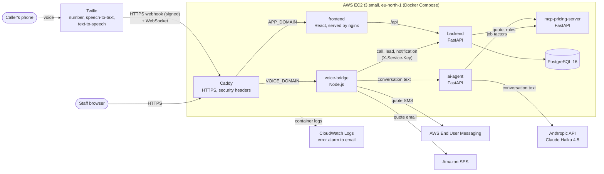
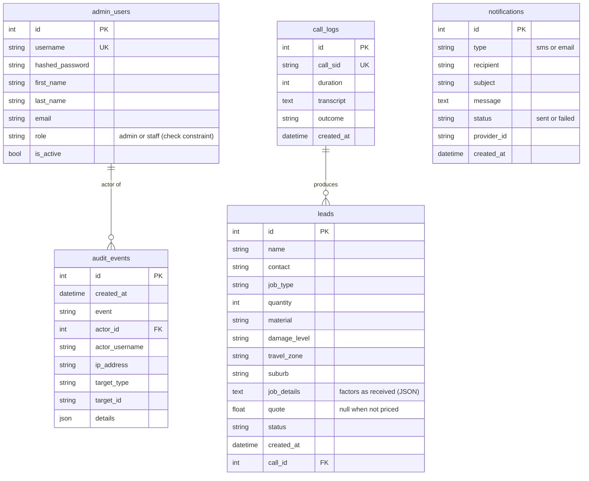

# Renovo Cape: AI Phone Receptionist

## Final Project Report

| | |
|---|---|
| Module | INSY7315, Information Systems 3E: Work Integrated Learning |
| Team | YandaTech |
| Client | Renovo Cape, Parow, Cape Town |
| Team members | Aliyu Yahaya Haliru (ST10440112), Nikita Correia Freire (ST10279031), Adam Benting (ST10440722), Yaseera Khan (ST10456786), Demira Yashwant Harry (ST10443785) |
| Repository | `github.com/YandaTech/INSY7315-Renovo` |
| Live dashboard | https://app.16-192-12-251.sslip.io |
| Live voice webhook | https://voice.16-192-12-251.sslip.io/voice (Twilio only) |
| Lecturer / marker | Amber Bruil (Task 2 marker; lecturer name: team to confirm) |
| Date | November 2026 (submission date: team to confirm) |
| Status of this document | Draft for the team to edit and agree. Items marked "(team to confirm)" need a team decision or fact |

**About this draft.** The brief asks for the Task 1 report to be updated with
the Task 2 feedback. No copy of the Task 1 report is in the repository or in
the `reference/` folder, so this draft is written from the code, the plan in
`ajiya/`, the deployment documents and the Task 2 marking sheet. Where a Task 1
section should be carried over (for example the original problem statement,
the methodology or the project plan), a note in the text says so. Paste the
Task 1 text there and update it with what changed. (team to confirm)

---

## Contents

1. Introduction
2. Requirements
3. System design
4. Implementation highlights
5. Security
6. Deployment and operations
7. Testing
8. Response to Task 2 feedback
9. Limitations and future work
10. Team contributions
11. References
12. Appendices

---

## 1. Introduction

### 1.1 The client

Renovo Cape is a small business in Parow that serves greater Cape Town. It
resurfaces and restores baths, sinks, tiles, shower trays, sanitaryware,
counter-tops, vanities and kitchen and bedroom cupboards, as a cheaper
alternative to replacing them. Most new work starts with a phone call.

(Task 1: paste the client background, contact person and the way the
requirements were gathered here. team to confirm)

### 1.2 The problem

- Calls arrive while the team is on site or after hours. An unanswered call is
  often a lost job, because the customer phones the next company.
- Customers want a price straight away, but every quote needs a call-back.
- Enquiries are not kept in one place, so follow-ups are missed and the owner
  cannot see how many calls became work.

### 1.3 The solution

Renovo is an AI phone receptionist with a staff dashboard.

1. A customer phones the Renovo Cape number (a Twilio number).
2. An AI assistant answers. It tells the caller that it is an AI and that the
   call is transcribed, asks about the job (type, material, damage, quantity,
   suburb) and gives an estimate calculated from the business's own price
   rules.
3. If the caller gives a mobile number or an email address, the quote is sent
   to them by SMS and email after the call.
4. When the call ends, the call, its transcript and a lead (name, contact,
   job, quote) are saved.
5. Staff log in to a web dashboard to work the leads, log calls that came in
   another way, change prices, and see statistics. An admin manages staff
   accounts and can read an audit log of security events.

The system is live on AWS and answers real calls (see section 6).

---

## 2. Requirements

The Task 2 marker noted that "it was not clear who the client is or what the
user requirements and user stories are". This section states them and links
each one to the feature that meets it. The same mapping is on the printed
requirements sheet for the Expo (`expo/print/handout-requirements.html`).

### 2.1 Users

| User | Who | Main need |
|---|---|---|
| Caller | A member of the public with something to restore | A price now, without waiting for a call-back |
| Staff | Renovo Cape team members | One list of enquiries to follow up |
| Owner / admin | The business owner | Control of prices, staff access and customer data |

### 2.2 Functional requirements as user stories

| # | As a | I want to | So that | How the system does it | Status |
|---|---|---|---|---|---|
| US1 | Caller | get an estimate at any time of day | I don't wait for a call-back | The AI assistant answers 24/7, collects the job factors and quotes from the pricing server's rules | Done |
| US2 | Caller | know that I am talking to an AI and that the call is transcribed | I can decide what to share | The greeting says so (`voice-bridge/src/greeting.js`); the agent answers honestly if asked whether it is a person | Done |
| US3 | Caller | receive my quote in writing | I have a record of the price | SMS through AWS End User Messaging and email through Amazon SES after a quoted call | Done (AWS sandbox: verified recipients only, see 9) |
| US4 | Staff | see every call as a lead with the job, quote and transcript | I can call back with context | Each call is saved as a lead; the lead panel shows job, quote, call length and transcript | Done |
| US5 | Staff | move leads from new to closed, and filter and search them | nothing is missed | Status per lead (new, contacted, confirmed, closed, incomplete), filters and search | Done |
| US6 | Staff | log calls that came in another way | all enquiries are in one place | The Log a call dialog prices the job with the same pricing server | Done |
| US7 | Owner | change prices without a developer | quotes stay correct | The Pricing page edits the rules; the next call uses them | Done |
| US8 | Owner | see call, lead and notification statistics | I can see how the business is doing | The Statistics page shows calls, leads, top services and SMS/email sent and failed counts | Done |
| US9 | Owner | control who can use the dashboard, and remove access at once | ex-staff cannot see customer data | Admin and staff roles; the Staff page creates, changes and deactivates accounts; deactivation ends open sessions | Done |
| US10 | Owner | see who did what, and when | I can investigate a problem | Append-only audit log and Audit log page with user and date filters | Done |
| US11 | Owner | keep customer data private, and delete it on request | we meet POPIA | Login on every route; deleting a lead deletes its call log and transcript; no caller details in logs or URLs | Done |

(Task 1: if the Task 1 report had different or numbered requirements, map
them to US1 to US11 here. team to confirm)

### 2.3 Non-functional requirements

| Quality | Requirement | How it is met | Evidence |
|---|---|---|---|
| Availability | Reachable over HTTPS at all times | Hosted on AWS EC2; every container restarts on failure; backend health check; uptime check every 10 minutes | `docker-compose.prod.yml`, `.github/workflows/uptime.yml` |
| Response time | The caller should not wait in silence | Claude Haiku 4.5 (a fast model) and short spoken replies; Twilio ConversationRelay streams text both ways over one WebSocket | `ai-agent/agent.py`, `voice-bridge/src/websocket.js` |
| Security | Only staff see customer data; no brute force | Login on every data route, roles checked on the server, 5 login attempts a minute per client IP, signed Twilio webhooks | Section 5 |
| Privacy | POPIA: openness, minimal data, deletion | AI and transcription disclosure, delete on request, masked phone numbers in logs | Section 5.3 |
| Recoverability | Data survives a bad change | Nightly `pg_dump`, kept 14 days | `deploy/backup.sh` |
| Maintainability | Changes are tested and dependencies are safe | 216 automated tests run in CI on every push, plus dependency vulnerability scans | Section 7 |
| Usability and accessibility | Usable on phone and desktop, with a keyboard | Responsive layout, labelled controls, focus styles, focus trap in dialogs, toasts for failures | `frontend/src/lib/useFocusTrap.ts`, `frontend/src/lib/useToast.ts` |

---

## 3. System design

### 3.1 Architecture

The system is six application services and a database, each in its own
Docker container. Caddy is the only service with public ports.



### 3.2 Components

| Component | Technology | Responsibility | Main files |
|---|---|---|---|
| `voice-bridge` | Node.js 22, Express 5, `ws` | Receives Twilio's webhook, checks its signature, returns TwiML that starts ConversationRelay, holds the WebSocket for the call, passes each caller turn to the agent, and at the end saves the call and lead and sends the quote SMS and email | `voice-bridge/src/webhook.js`, `websocket.js`, `callState.js`, `notifications.js`, `quoteConfirmation.js`, `privacy.js` |
| `ai-agent` | Python, FastAPI, Anthropic SDK | Runs the conversation with Claude Haiku 4.5 (`claude-haiku-4-5-20251001`), with a `get_quote` tool that calls the pricing server | `ai-agent/agent.py`, `tools.py`, `prompts.py`, `conversation_manager.py` |
| `mcp-pricing-server` | Python, FastAPI | Calculates a quote from the rules file: base price per service, material and damage surcharges (percent) and a travel-zone fee. Validates rules before saving them | `mcp-pricing-server/pricing_engine.py`, `server.py`, `config/pricing_rules.json` |
| `backend` | Python 3.12, FastAPI, SQLAlchemy 2, Alembic | REST API for calls, leads, notifications, pricing, users, audit log and demo-phone tokens. Auth, roles, rate limiting, audit log | `backend/app/main.py`, `routes/`, `models/`, `services/`, `core/` |
| `frontend` | React 19, TypeScript, Vite, Tailwind CSS 4, Recharts | Staff dashboard: leads, lead panel, Log a call, Pricing, Statistics, Staff, Audit log, Profile, Demo call | `frontend/src/pages/`, `components/`, `lib/` |
| `db` | PostgreSQL 16 (Alpine image) | Stores users, calls, leads, notifications and audit events | `docker-compose.prod.yml` |
| `caddy` | Caddy 2 | HTTPS with automatic Let's Encrypt certificates for two hostnames, reverse proxy, security headers and CSP | `deploy/Caddyfile` |

The pricing rules hold 10 services in 4 categories, with material and damage
surcharges and travel zones, priced in rand (ZAR).

### 3.3 Call sequence

1. Twilio posts to `https://<VOICE_DOMAIN>/voice`. voice-bridge rejects the
   request with 403 unless the `X-Twilio-Signature` header is valid.
2. voice-bridge answers with TwiML that connects the call to ConversationRelay
   at `wss://<VOICE_DOMAIN>/`, with the welcome greeting.
3. Twilio converts the caller's speech to text and sends each turn over the
   WebSocket. voice-bridge only accepts a stream for a call it saw in a signed
   webhook.
4. voice-bridge sends the turn to ai-agent. The agent replies, and when it has
   enough job factors it calls the pricing server through the `get_quote` tool.
5. The reply text goes back over the WebSocket and Twilio speaks it.
6. When the call ends, voice-bridge posts the call (with transcript) and the
   lead to the backend as JSON bodies, then sends the quote SMS and email and
   records each one as a notification (`sent` or `failed`).
7. If pricing fails, the lead is saved with no quote (shown as "Pending"), and
   the agent tells the caller the team will call back with a price. It never
   quotes R0.

### 3.4 Data model



Design points:

- **Job details are real columns** (`job_type`, `quantity`, `material`,
  `damage_level`, `travel_zone`, `suburb`) so leads can be filtered and
  reported on. `job_details` keeps the factors exactly as received.
- **Indexes** on `call_sid` (unique), `username` (unique), `leads.job_type`,
  `notifications.type` and `status`, and `audit_events.created_at`, `event`
  and `actor_id`.
- **Integrity**: a check constraint limits `role` to `admin` or `staff`. Users
  are deactivated, never deleted, so audit events still point at a real user.
- **The audit log is append-only** at three levels: the ORM refuses updates and
  deletes, database triggers refuse them (migration `0004_audit_events`), and
  the API has no endpoint that changes an event.
- **Migrations**: four Alembic migrations in `backend/alembic/versions/`
  (`0001_baseline`, `0002_lead_job_columns`, `0003_user_roles`,
  `0004_audit_events`). `backend/app/migrate.py` runs them every time the
  backend container starts.
- **Single tenant**: the system serves one business. Isolation is by
  deployment (one server, one database, one set of secrets), not by a tenant
  column (`docs/security-design.md` section 2).

### 3.5 API

All bodies are typed JSON (Pydantic schemas in `backend/app/schemas.py`).
Personal data never appears in a URL. In production the interactive docs
(`/docs`, `/redoc`, `/openapi.json`) are hidden; in development they are at
`http://localhost:8000/docs`.

| Area | Endpoints | Who can call it |
|---|---|---|
| System | `GET /`, `GET /health` | Anyone |
| Auth | `POST /auth/register` (only while no account exists), `GET /auth/registration-open`, `POST /auth/login` (5 a minute), `POST /auth/logout`, `GET` and `PATCH /auth/me`, `POST /auth/me/password` | Public for register and login; logged-in user for the rest |
| Calls | `POST /calls/`; `GET /calls/`, `GET /calls/{call_sid}` | Admin or voice-bridge (service key) to create; logged-in user to read |
| Leads | `POST /leads/`; `GET /leads/`, `GET /leads/{id}`, `PATCH /leads/{id}/status`, `DELETE /leads/{id}` | Admin or service to create; logged-in user for the rest |
| Notifications | `POST /notifications/`; `GET /notifications/`, `GET /notifications/stats` | Admin or service to create; logged-in user to read |
| Pricing | `POST /pricing/calculate`; `GET /pricing/rules`; `PUT /pricing/rules` | Admin or service; logged-in user; admin only |
| Staff | `GET /users/`, `POST /users/`, `PATCH /users/{id}` | Admin only |
| Audit log | `GET /audit-events/` (paged, filter by user and date) | Admin only |
| Demo phone | `GET /voice/token` | Logged-in user (a short-lived Twilio Voice SDK token that can only call the Renovo app) |

Status codes follow HTTP rules: 201 on create, 204 on delete and password
change, 401 without a valid session, 403 for a staff user on an admin route,
404 for an unknown record, 422 for an invalid body and 429 when the login
limit is hit.

---

## 4. Implementation highlights

### 4.1 Backend structure

`backend/app/main.py` is 76 lines. It creates the app, adds middleware and
registers eight routers. The code is layered:

- `routes/`: HTTP only (parsing, status codes, permission dependencies).
- `services/`: business logic (`lead_service.py`, `pricing_service.py`,
  `audit.py`).
- `repositories/`: database access for calls, leads and notifications.
- `models/` and `schemas.py`: SQLAlchemy tables and Pydantic request and
  response types.
- `core/`: settings, security (password hashing, JWT, cookie), permission
  dependencies and the rate limiter.

### 4.2 Pricing that fails safely

The pricing engine validates the rules file before saving it and returns a
clear error for unknown factors. Before Task 2, a pricing failure produced an
R0 quote. Now (commits `5c763b4`, `e47c703`, `6dd0202`, `0109893`, `3c2b66e`):

- the lead is saved with `quote = null`, and the dashboard shows "Pending";
- the agent tells the caller that the team will call back with a price;
- an incomplete call leaves the lead unquoted instead of guessing.

### 4.3 Quote confirmations by SMS and email

`voice-bridge/src/notifications.js` sends the quote:

- **SMS** through AWS End User Messaging (`SendTextMessage`, SDK
  `@aws-sdk/client-pinpoint-sms-voice-v2`). SMSPortal and Twilio are
  supported as alternatives, chosen by `SMS_PROVIDER`.
- **Email** through Amazon SES v2 (`SendEmail`) if the caller gives an email
  address on the call, chosen by `EMAIL_PROVIDER`.
- Both use the EC2 instance role, so no AWS keys are stored on the server.
- Each attempt is saved as a notification with status `sent` or `failed`. The
  Statistics page shows the counts.
- Exactly one email is sent per quoted call (tested in
  `voice-bridge/test/quoteEmail.test.js`).

### 4.4 Session, roles and audit log

- **Session**: login sets the JWT in an `httpOnly`, `SameSite=Strict` cookie,
  marked `Secure` in production (`backend/app/core/security.py`). The
  dashboard no longer keeps a token in `localStorage` (`e74f8c7`). Logout
  clears the cookie and is recorded in the audit log.
- **Roles**: `admin` and `staff`. The role and `is_active` flag are read from
  the database on every request, so a role change or deactivation applies at
  once, not when the token expires (`049c004`).
- **Audit log**: logins (succeeded and failed), logout, password and profile
  changes, user created, role changed, deactivated and reactivated, lead
  deleted and pricing updated are recorded with actor, time, IP address and
  target (`5a44fa2`). `backend/app/services/audit.py` refuses details whose
  keys look like passwords, tokens, phone numbers, emails or transcripts.

### 4.5 Dashboard user experience

- Every failed action (status update, delete, loading leads, logging a call,
  loading a call log, pricing failure) shows a toast in an `aria-live` region
  instead of only logging to the console (`1ac961d`, `81a05ca`).
- One shared focus trap (`useFocusTrap.ts`) is used by the lead panel and the
  Log a call dialog. Escape closes the dialog and focus returns to the button
  that opened it (`13621be`).
- The unused Vite template files were removed (`b7d1c7c`).
- New pages: Staff (`a390158`), Audit log (`d656b80`) and SMS/email counts on
  Statistics (`a9f68ae`).
- The Demo call page lets staff call the AI from the browser with the Twilio
  Voice SDK, which is useful for demos and for checking a deploy.

(Screenshots of each page: team to add before submission.)

---

## 5. Security

### 5.1 Threats and controls

| Threat | Control | Where |
|---|---|---|
| Someone reads customer data without logging in | Every data route needs a valid session or the service key; 401 otherwise | `backend/app/core/dependencies.py` |
| A staff user does admin work | Admin-only routes check the role on the server (403) | `require_admin` in `dependencies.py` |
| Password guessing | 5 login attempts a minute per real client IP (429). Uvicorn runs with `--proxy-headers` and trusts only the Docker network, so the IP cannot be faked and users do not share one limit | `backend/app/core/limiter.py`, `backend/Dockerfile` |
| Stolen token through XSS | Token only in an `httpOnly` cookie; Content-Security-Policy | `core/security.py`, `deploy/Caddyfile` |
| Cross-site request forgery | `SameSite=Strict` cookie | `core/security.py` |
| Ex-staff keep access | Deactivation blocks login and ends open sessions | `049c004` |
| Fake calls or forged Twilio requests | Valid `X-Twilio-Signature` required in production; a WebSocket is accepted only for a call from a signed webhook; voice-bridge refuses to start without the Twilio auth token (fails closed) | `voice-bridge/src/twilioSignature.js` |
| An outsider writes leads or calls | voice-bridge uses a shared `SERVICE_API_KEY`, compared in constant time | `dependencies.py` |
| Direct access to internal services | Only Caddy publishes ports (80, 443). Backend, ai-agent, pricing server and PostgreSQL are on the internal Docker network only. SSH port 22 is closed; admins connect through AWS Systems Manager | `docker-compose.prod.yml`, `deploy/README.md` |
| Data read in transit | HTTPS everywhere (Let's Encrypt via Caddy), HSTS | `deploy/Caddyfile` |
| Clickjacking, MIME sniffing | `X-Frame-Options`, `X-Content-Type-Options`, `Referrer-Policy`, `Permissions-Policy` | `deploy/Caddyfile` |
| API discovery | `/docs`, `/redoc`, `/openapi.json` hidden in production | `backend/app/main.py` |
| Vulnerable dependencies | Every dependency pinned; `npm audit` and `pip-audit` fail CI on known vulnerabilities | `.github/workflows/ci-cd.yml`, `docs/security/supply-chain/` |
| Secrets leak | Secrets only in `~/renovo/.env` on the server (mode 600), never in git; AWS access by instance role, not keys; rotation steps documented | `docs/incident-response.md` section 7 |
| Unsafe input | Pydantic validates every body; SQLAlchemy uses parameterised queries; pricing rules are validated before they are saved | `schemas.py`, `pricing_engine.py` |

The live system can be checked from outside:

- `GET https://app.16-192-12-251.sslip.io/api/leads/` without a session
  returns 401.
- An unsigned `POST https://voice.16-192-12-251.sslip.io/voice` returns 403.
- A sixth login attempt in one minute returns 429.

(The first two were checked on 4 Nov 2026 while writing this report.)

### 5.2 Supply chain

On 2 Nov 2026 we ran `npm audit` and `pip-audit` on all five services,
patched the vulnerable packages and pinned every dependency (`fdfb744`). The
before and after outputs are in `docs/security/supply-chain/before/` and
`after/`, with a summary in `docs/security/supply-chain/summary.txt`. CI now
runs the same scans on every push and fails on any finding.

### 5.3 Privacy and POPIA

Renovo Cape is the responsible party; the team runs the system as its
operator; callers are the data subjects. The full analysis is in
`docs/security-design.md`.

| Condition | What we did |
|---|---|
| Openness (section 18) | The greeting says: "Thanks for calling Renovo Cape. I'm the AI assistant, and this call is transcribed so our team can follow up." (`voice-bridge/src/greeting.js`, `a2f8e6a`) |
| Minimality | The agent asks only for name, mobile number, optional email, suburb and job details. The pricing server receives job factors only, never a name or number |
| Security safeguards (section 19) | Section 5.1 |
| Data subject participation | Staff can delete a lead; its call log and transcript are deleted with it (`c9320a1`). Deleted data leaves the backups after 14 days |
| No personal data in logs or URLs | Logs hold call IDs, lengths and outcomes. Phone numbers are masked (`+2782*****67`) and conversation text is never logged in production (`voice-bridge/src/privacy.js`, `a80e61c`). Call and lead data are sent in JSON bodies, never query strings (`d7019de`, `ce47cfa`) |
| Further processing | Numbers are used only to send the quote the caller asked for, not for marketing |
| Transborder flows (section 72) | Our server is in Stockholm (`eu-north-1`). Twilio, Anthropic and AWS process call data outside South Africa. Renovo Cape's privacy notice should name them (team to confirm with client) |

### 5.4 AI and call-recording disclosure

- **AI disclosure**: the caller hears that they are speaking to an AI
  assistant in the first sentence of every call. The system prompt tells the
  agent to answer honestly if asked whether it is a person
  (`ai-agent/prompts.py`).
- **Transcription disclosure**: the same sentence says the call is
  transcribed. Twilio converts speech to text; the text transcript is stored
  with the call log.
- **Audio recording**: our code does not ask Twilio to record call audio.
  Only the text transcript is stored. Whether recording is switched off on the
  Twilio number itself has to be checked in the Twilio account, which the team
  does not own (team to confirm).
- **AI estimates**: the agent gives an estimate, not a binding quote. The
  price comes from the pricing rules, not from the language model.

---

## 6. Deployment and operations

### 6.1 Hosting

| Item | Value |
|---|---|
| Server | AWS EC2 `t3.small` (2 vCPU, 2 GB RAM), Ubuntu 24.04 LTS, 20 GB gp3 disk, 2 GB swap, Elastic IP |
| Region | `eu-north-1` (Stockholm) |
| Runtime | Docker Compose, `docker-compose.prod.yml`, 7 containers (`db`, `backend`, `mcp-pricing-server`, `ai-agent`, `voice-bridge`, `frontend`, `caddy`) |
| Public entry | Caddy on ports 80 and 443 only |
| Hostnames | `app.16-192-12-251.sslip.io` (dashboard) and `voice.16-192-12-251.sslip.io` (Twilio), free `sslip.io` names built from the Elastic IP |
| TLS | Let's Encrypt certificates obtained and renewed by Caddy |
| Admin access | AWS Systems Manager Session Manager; port 22 closed |
| Database | PostgreSQL 16 container with data in the `pg_data` volume; port not published |

Persistent data lives in named volumes: `pg_data` (database),
`pricing_config` (price edits), `caddy_data` (certificates) and
`backend_data` (the old SQLite file, mounted read-only as a fallback).

### 6.2 Why EC2 and Caddy instead of Railway

The Task 2 plan named Railway. We moved to one EC2 instance with Caddy
because (full reasoning in `deploy/README.md`, "Why EC2 and Caddy instead of
Railway"):

- **One Compose file runs the whole stack.** Seven containers that talk to
  each other run from one file, the same way as in development. On Railway
  each service is set up separately.
- **A long-lived WebSocket.** ConversationRelay keeps a WebSocket open for the
  whole call. On our own server Caddy proxies it directly, with no platform
  request limits in between.
- **Two HTTPS hostnames for free.** Caddy handles certificates for both
  hostnames without buying a domain.
- **One AWS account for hosting, SMS and email**, all authorised by the
  instance role, so no SMS or email keys are stored.
- **A fixed monthly cost** for one `t3.small`, instead of usage billing (team
  to confirm cost was part of the decision).
- **Smaller attack surface**: two open ports and no SSH.

Trade-offs: one server is a single point of failure, there is no
autoscaling, and we patch the OS and run backups ourselves. Section 9 lists
what would reduce these.

### 6.3 Production database

Production moved from SQLite to PostgreSQL 16 on 3 to 4 Nov 2026 (`380cc93`).
The decision record in `deploy/README.md` compares three options:

| Option | Result |
|---|---|
| Stay on SQLite | Rejected: one writer at a time, and the marker asked us to move off it |
| Amazon RDS for PostgreSQL | Rejected for now: about $14 a month extra for a `db.t4g.micro` with 20 GB in `eu-north-1` |
| PostgreSQL container on the same EC2 instance | Chosen: no extra cost, same network and deploy |

Existing data was copied across with `backend/app/copy_sqlite.py`, which is
tested against PostgreSQL in CI. Moving to RDS later only needs a new
`DATABASE_URL`.

### 6.4 Backups

`deploy/backup.sh` runs at 02:00 every night from cron and writes a
`pg_dump` to `~/backups`, readable by the `ubuntu` user only, kept for 14
days. The automatic deploy script also takes a dump before every deploy.
Restore steps are in `deploy/README.md` and `docs/incident-response.md`
section 9. A full restore test has not been done yet (RN-0034, section 9).

### 6.5 Monitoring and alerts

| What | How | Who is told |
|---|---|---|
| Logs | Every container logs to CloudWatch Logs, group `/renovo/prod`, kept 14 days. Logs hold call IDs and masked numbers only | Read in CloudWatch or with `docker compose logs` |
| Errors | Metric filter `renovo-errors` counts lines with `Traceback`, `ERROR:`, `Error:` or `Unhandled`. Alarm `renovo-app-errors` fires on 1 or more in 5 minutes | Email to the team through SNS topic `renovo-alerts` |
| Downtime | `.github/workflows/uptime.yml` runs every 10 minutes: dashboard loads, `/api/health` answers, and `/voice` answers 403 to an unsigned request | GitHub emails on a failed run |
| Container health | Backend health check; `restart: unless-stopped` on every service; voice-bridge and frontend wait for a healthy backend | Docker restarts it |

The organisation's AWS account blocks `us-east-1`, where Route 53 health-check
alarms must live, so the uptime check runs on GitHub Actions instead.

### 6.6 Incident response

`docs/incident-response.md` is the runbook: how to connect, check health and
read logs, what to do when a service is down, how to rotate a leaked secret
for each service, POPIA breach notification steps (section 22: notify Renovo
Cape, which notifies the Information Regulator and affected callers), and how
to restore data.

### 6.7 CI/CD

**Continuous integration** (`.github/workflows/ci-cd.yml`) runs on every push
to every branch and on pull requests to `main`. It has 7 jobs:

| # | Job | What it checks |
|---|---|---|
| 1 | Backend Lint & Pytest | `black --check`, `flake8`, and `pytest` against a PostgreSQL 16 service container |
| 2 | Frontend Build & Verification | ESLint, Vitest unit tests, production build |
| 3 | Pricing Server Pytest | Pricing engine tests |
| 4 | Voice Bridge Node Tests | `node --test` suite |
| 5 | AI Agent Import Check | Compiles and imports the agent |
| 6 | Docker Build Validation | Builds every image with `docker compose build` after jobs 1 to 5 pass |
| 7 | Dependency Security Scans | `npm audit --audit-level=high` for frontend and voice-bridge; `pip-audit` for backend, pricing server and ai-agent |

**Deployment**: deploys copy one commit to the server with `git archive`,
unpack it into a fresh folder, keep the `.env` files, rebuild with Compose,
and check `/api/health` and a test call. `deploy/autodeploy.sh` and a systemd
timer (`deploy/systemd/`) automate this: every 5 minutes the server checks
`main`, backs up the database, deploys a new commit, and rolls back to the
previous folder if the health check fails within 3 minutes. It also deploys a
named commit for a manual rollback. The script is written (`dbd8c62`), but it
needs a read-only deploy key on GitHub before it can run (RN-0031, RN-0032),
so deploys are still started by hand (team to confirm before submission).

---

## 7. Testing

### 7.1 Automated tests

Counts are from running each suite on branch `ali-dev` on 4 Nov 2026.

| Service | Framework | Tests | What they cover | In CI |
|---|---|---|---|---|
| backend | pytest | 101 (98 run locally; 3 need PostgreSQL and run in CI) | Auth and cookie session, logout, rate limit, roles and deactivation, audit log append-only rules, leads, calls, notifications, privacy of logs, API docs hidden in production, Alembic migrations on SQLite and PostgreSQL, SQLite-to-PostgreSQL copy, demo phone token | Yes |
| frontend | Vitest, Testing Library | 65 in 15 files | API client, session provider, protected routes, login page, Staff page, Audit log page, focus trap, toasts, status labels, quote display, job details, notifications | Yes |
| voice-bridge | `node --test` | 42 | Twilio signature check, greeting, phone masking, WebSocket call flow, quote SMS and quote email | Yes |
| mcp-pricing-server | pytest | 8 | Quote calculation, surcharges, travel fees, rule validation | Yes |
| ai-agent | pytest | 7 | `get_quote` when the pricing server is down or returns an error (no quote, never R0), contact details kept away from the pricing server, prompt asks for and confirms an email | No (CI runs an import check only) |
| **Total** | | **223** (216 in CI) | | |

### 7.2 Security testing

| Kind | What we do | Status |
|---|---|---|
| Software composition analysis | `npm audit` and `pip-audit` in CI on every push | Done |
| Security unit tests | 401, 403 and 429 cases, cookie flags, signature rejection, audit log refusals, no personal data in logs | Done |
| Live checks | 401 without a session, 403 for an unsigned webhook, uptime workflow checks the 403 every 10 minutes | Done |
| Dynamic scans (Nmap, OWASP ZAP) | Planned baseline and retest (RN-0005, RN-0006, RN-0037) | Not done (team to confirm whether this belongs in this module) |

### 7.3 Manual end-to-end call test

After each deploy:

1. `curl -fsS https://app.16-192-12-251.sslip.io/api/health` returns
   `{"status":"ok"}`.
2. A staff user logs in and opens the **Demo call** page with the browser
   console open, and checks there are no Content-Security-Policy errors.
3. A real phone calls the Twilio number. The caller hears the AI and
   transcription disclosure, describes a job (for example a cast-iron bath
   with heavy damage in the southern suburbs), gives a verified mobile number
   and email, and gets a spoken estimate.
4. Expected results: a new lead on the dashboard with job columns, quote and
   transcript; an SMS and an email with the same quote; the Statistics page
   counts go up by one SMS and one email sent.
5. Delete the test lead and check its call log is gone.

Test log (team to fill in): date, tester, phone used, quote heard, SMS
received (yes/no), email received (yes/no), lead correct (yes/no).

---

## 8. Response to Task 2 feedback

Task 2 result: Section 1, Code and Implementation, 122/210 (58%); Section 2,
Presentation, 40/60 (67%); total 162/270 (60%). Marked by Amber Bruil. Overall
comment: "Strong architecture and branching, but the app isn't hosted, the
pipeline is limited and the presentation barely covered requirements."

Commits are on branch `ali-dev` unless stated. Ticket IDs refer to the plan in
`ajiya/`.

### 8.1 Section 1: Code and Implementation

| Criterion and mark | Marker comment | What we changed | Evidence |
|---|---|---|---|
| Front End: Visual Design and Branding, 7/10 | Remove the unused Vite template files (`react.svg`, `vite.svg`, `hero.png`) from `src/assets`. | Removed them; `frontend/src/assets` no longer exists. | `b7d1c7c`; RN-0026 |
| Front End: UX and Feedback, 6/10 | Failed updates, deletes and filters only log to the console; the user should see a toast. | Every failed action shows a toast: status update, delete, loading leads, logging a call, loading a call log and pricing failure. Toasts are announced to screen readers. | `frontend/src/lib/useToast.ts`, `frontend/src/pages/Dashboard.tsx`; `1ac961d`, `81a05ca`; RN-0026 |
| Front End: Responsiveness and Accessibility, 10/15 | Add a focus trap to dialogs so keyboard users cannot tab out of an open modal. | One shared focus trap for the lead panel and the Log a call dialog; Escape closes; focus returns to the opening button. Unit tested. | `frontend/src/lib/useFocusTrap.ts`, `useFocusTrap.test.tsx`; `13621be`; RN-0027 |
| Back End: Programming Skills, 17/25 | Move the routes still in `main.py` into routers. | `main.py` is 76 lines and only registers 8 routers (`auth`, `calls`, `leads`, `pricing`, `notifications`, `users`, `audit`, `voice`). | `backend/app/routes/`; `92e2b15` (Demira), `e86333c`; RN-0015 |
| | Surface pricing failures instead of showing an R0 quote. | A failed or incomplete quote leaves `quote` null; the dashboard shows "Pending"; the agent tells the caller the team will call back with a price. | `5c763b4`, `e47c703`, `6dd0202`, `0109893`, `3c2b66e`; RN-0016 |
| Back End: Database, 10/20 | Model all the planned entities. | Added `audit_events` and user roles and active flag; the model now has users, calls, leads, notifications and audit events (section 3.4). (team to confirm the list of entities planned in Task 1 and whether any are still missing) | `backend/app/models/`; `049c004`, `5a44fa2` |
| | Give job details real columns. | `job_type`, `quantity`, `material`, `damage_level`, `travel_zone`, `suburb` are columns on `leads`, with an index on `job_type`. | Migration `0002_lead_job_columns.py`; `f174a31`; RN-0021 |
| | Add migrations. | Alembic with 4 migrations, run automatically when the backend starts; tested on SQLite and PostgreSQL in CI. | `backend/alembic/versions/`, `backend/app/migrate.py`, `backend/tests/test_migrations.py`; `f174a31`; RN-0020 |
| | Move production off SQLite. | Production runs PostgreSQL 16 in the Compose stack; data copied with a tested script; decision record with costed alternatives. | `docker-compose.prod.yml`, `backend/app/copy_sqlite.py`, `deploy/README.md`; `380cc93`, `5b20f7f`; RN-0022 |
| Back End: APIs, 13/20 | Send `POST /calls` and `/leads` data, like transcripts, in the request body. | Calls, leads and notifications take typed JSON bodies. No name, number or transcript appears in any URL, so none reaches the access log. The Log a call form also sends JSON. | `backend/app/schemas.py`; `d7019de`, `ce47cfa`, `be1c562`, `2c8d655`; RN-0014 |
| Back End: Security, 13/20 | Login still needs rate limiting. | 5 attempts a minute per real client IP; returns 429. Behind Caddy and nginx, Uvicorn trusts forwarded headers only from the Docker network, so each visitor has their own limit. | `backend/app/core/limiter.py`, `backend/tests/test_rate_limit.py`; `cc92bb0` (Adam, on `main`), `0fbdb9d`; RN-0007 |
| | The JWT should move from `localStorage` into an httpOnly cookie. | Session cookie is `httpOnly`, `SameSite=Strict` and `Secure` in production; logout endpoint; the dashboard no longer stores or sends the token itself. | `backend/app/core/security.py`, `frontend/src/lib/SessionProvider.tsx`; `ec9d297` (Adam, on `main`), `2780dd2`, `e74f8c7`; RN-0008, RN-0009 |
| | (Not in the comment, added to reach the top band) | Admin and staff roles; deactivation ends sessions; Staff page; append-only audit log and Audit log page; signed Twilio webhooks required in production; security headers and CSP; API docs hidden in production; no personal data in logs; dependency scans in CI. | Section 5; RN-0010 to RN-0013, RN-0017, RN-0018, RN-0019, RN-0029, RN-0047 |
| Back End: Data Flow and Logic, 13/20 | Send the SMS and email confirmations (requirement 6) through a real provider, not just logs. | Quote SMS through AWS End User Messaging and quote email through Amazon SES, sent after every quoted call; each attempt saved as `sent` or `failed` and counted on the Statistics page. Both AWS accounts are in sandbox mode, so only verified numbers and addresses receive messages (section 9). | `voice-bridge/src/notifications.js`, `quoteConfirmation.js`; `76712e3`, `003bca7`, `5383fc5`, `a9f68ae`; RN-0023, RN-0025, RN-0043, RN-0046 |
| Hosting: Deployment and Connectivity, 6/20 | The app only runs on localhost and ngrok; deploying it to a live host is the priority. | Live on AWS EC2 with Docker Compose and Caddy (HTTPS). All seven containers talk over the internal network; Twilio reaches the voice hostname; real phone calls and browser calls work. | https://app.16-192-12-251.sslip.io; `deploy/README.md`; RN-0002 |
| Hosting: Stability and Rationale, 5/15 | Stability can't be shown until the app is on a live host. | Restart policies, backend health check with dependent start-up, nightly backups, CloudWatch logs with an error alarm, uptime check every 10 minutes from GitHub, incident runbook. | `docker-compose.prod.yml`, `deploy/backup.sh`, `.github/workflows/uptime.yml`, `docs/incident-response.md`; `281316c`, `76811bb` |
| | Explain why you moved from the Railway plan. | Written rationale with trade-offs, plus a costed decision record for the database. | `deploy/README.md` "Why EC2 and Caddy instead of Railway"; section 6.2; `5b20f7f`; RN-0003 |
| GitHub: Branching and Workflow, 13/15 | Turn on repo Insights so each member's share of work can be seen. | Not done yet: it needs the repository owner to change the settings. Section 10 lists each member's commits in the meantime. (team to confirm it is on before submission) | RN-0004 (pending) |
| GitHub: CI/CD and Pipelines, 9/20 | Run the voice-bridge and pricing tests in CI. | Both run on every push. | `.github/workflows/ci-cd.yml` jobs 3 and 4; `7939082`; RN-0028 |
| | Add frontend tests. | Vitest suite, 65 tests in 15 files, run in CI with lint and build. | `frontend/src/**/*.test.ts(x)`; `6371de8`; RN-0030 |
| | Add a deploy. | Pull-based automatic deploy of `main` with backup and health-check rollback is written; it waits on a GitHub deploy key. CI also builds every Docker image and runs security scans. (team to confirm whether it is switched on before submission) | `deploy/autodeploy.sh`, `deploy/systemd/`; `dbd8c62`; RN-0031, RN-0032 (pending) |

### 8.2 Section 2: Presentation

The presentation comments concern the Task 2 video. They are answered in how
we run the Expo presentation (RN-0041) and in this report.

| Criterion and mark | Marker comment | What we changed | Evidence |
|---|---|---|---|
| Technical Demo and Implementation, 15/20 | Security was skipped, and most features were explained rather than shown working. | The Expo demo is a live call to the hosted system, then each feature shown on screen, then a live security check: 401 without a login, 403 for an unsigned webhook, 429 after too many logins. This report documents security in section 5. | Expo run sheet (team to confirm); `expo/print/handout-feedback.html` |
| Architecture and System Design, 12/15 | Broken down well, with only relevant code snippets and no jargon. | Kept the same approach: one diagram, one component table and plain explanations (section 3). | Section 3 |
| GitHub and Version Control, 5/10 | Mentioned only briefly; the automation was not showcased. | At the Expo we open a passing GitHub Actions run and go through the 7 jobs, including the security scans, and show the uptime workflow. Section 6.7 describes the pipeline. | `.github/workflows/`; section 6.7 |
| Requirements Alignment, 1/5 | Requirements were hardly mentioned; not clear who the client is or what the user requirements and stories are. | The pitch opens with the client, the problem and the user stories. Section 2 of this report lists 11 user stories and the non-functional requirements, each mapped to a feature and its status. | Section 2; `expo/print/handout-requirements.html` |
| Presentation: Communication and Professionalism, 7/10 | Odd pauses and "ummm"; an audio track fades out too quickly and loses the end of a sentence; hasty jump cuts. | A rehearsed run sheet with timings for the live presentation. The backup demo video is one continuous take with steady audio. (team to confirm) | Expo run sheet and backup video (team to confirm) |

---

## 9. Limitations and future work

| Limitation | Effect | What would fix it |
|---|---|---|
| One EC2 server runs everything, including the database | A server or disk failure stops the service and could lose data since the last backup | Daily EBS snapshots with Data Lifecycle Manager; copy dumps to S3; later RDS and a second instance behind a load balancer |
| Backups are on the same disk, and a restore has not been tested | A lost disk loses the backups too; an untested backup may not restore | Off-server copies and a dated restore test (RN-0034) |
| AWS SMS and SES are in sandbox mode | Only verified phone numbers and email addresses receive quotes. Real customers would not get them | Register an origination identity for South Africa and request SMS and SES production access |
| The email sender is a Gmail address | Messages from a Gmail address sent through SES fail Gmail's DMARC check and can be rejected or marked as spam | Verify a domain Renovo Cape owns in SES, with SPF, DKIM and DMARC |
| A JWT stays valid until it expires after logout | Logout clears the cookie, but a copy of the token taken before logout works for up to 60 minutes. Deactivation does end it, because the active flag is checked on every request | Store a session ID or token version in the database and check it on each request; shorter tokens with refresh |
| Automatic deploy not switched on | Deploys are still started by hand | Add the deploy key and enable the timer (RN-0031, RN-0032) |
| Error alerts come from log patterns | Errors that are not logged with those words are missed; no grouping of errors | An error tracker such as Sentry, or structured logs with levels |
| No automatic data retention | Leads, transcripts and notifications are kept until someone deletes them | A scheduled clean-up based on the retention periods proposed in `docs/security-design.md` section 5, once Renovo Cape agrees them |
| No written operator agreement with Renovo Cape | POPIA section 21 expects one | Sign an agreement before real use |
| The Twilio account is not owned by the team or the client (team to confirm) | The client cannot control the number, its billing or its recording settings | Move the number to a Twilio account owned by Renovo Cape |
| Free `sslip.io` hostnames | Not a business address; tied to the Elastic IP | A Renovo Cape domain |
| The AI can mishear or misunderstand | A wrong job factor gives a wrong estimate | Estimates are presented as estimates; staff confirm on call-back; transcripts let staff check what was said |
| No dynamic security scan yet | Only dependency and unit-level security testing | Nmap and OWASP ZAP baseline, fixes and retest (RN-0005, RN-0006, RN-0037) |
| ai-agent tests do not run in CI | A change to the agent's tool could pass CI | Add its 7 pytest tests to job 5 |
| Multi-tenant use is out of scope | A second business needs its own stack | Tenant column and checks on every query, if needed |

---

## 10. Team contributions

Commit counts are from `git log` on branch `ali-dev` on 4 Nov 2026, including
merge commits and, for Aliyu, the commits that update the Ajiya plan. They
show activity, not the size of each person's work. Every member should check
their own row. (team to confirm all roles and descriptions)

| Member | Role | Main contributions | Commits |
|---|---|---|---|
| Aliyu Yahaya | Voice pipeline, hosting, CI/CD, security | Repository set-up; pricing engine and server; Claude Haiku agent on Twilio ConversationRelay; calls becoming leads with transcripts; Docker Compose stack; AWS EC2 and Caddy deployment; PostgreSQL move and backups; CloudWatch alarm and uptime check; CI expansion and security scans; roles, audit log, Staff and Audit log pages; Demo call page; project plan | 123 |
| Nikita Correia Freire | SMS and email notifications | voice-bridge service (webhook, WebSocket stream, call state, saving calls); notification log in the backend; SMS and email sending functions | 24 |
| Adam Benting | Authentication, rate limiting, CI | bcrypt and JWT authentication; protected endpoints and auth tests; Dockerfiles; first CI pipeline; login rate limit; httpOnly cookie with logout; PostgreSQL connection pooling; CI frontend and Docker build checks | 15 |
| Yaseera | Dashboard frontend | All original dashboard pages and their backend wiring; toast notifications; focus trap on the lead panel; removal of unused Vite assets | 13 |
| Demira Harry | Backend API and database | Original FastAPI backend, Swagger docs and CORS; split the backend into routers, repositories and services, with schema fixes and pricing-service error handling (`92e2b15`); database test and import fixes, merged on 3 Nov 2026 | 10 |

(Each member: add one or two sentences on what you learned or would do
differently, if the brief asks for it. team to confirm)

---

## 11. References

- Anthropic (2026) *Claude API documentation: models and tool use.* Available
  at: https://docs.anthropic.com (accessed November 2026).
- Amazon Web Services (2026) *AWS End User Messaging SMS user guide.*
  Available at: https://docs.aws.amazon.com/sms-voice/ (accessed November
  2026).
- Amazon Web Services (2026) *Amazon SES developer guide: sandbox and
  verified identities.* Available at: https://docs.aws.amazon.com/ses/
  (accessed November 2026).
- Amazon Web Services (2026) *Amazon RDS for PostgreSQL pricing.* Available
  at: https://aws.amazon.com/rds/postgresql/pricing/ (accessed 29 October
  2026).
- Caddy (2026) *Automatic HTTPS.* Available at:
  https://caddyserver.com/docs/automatic-https (accessed November 2026).
- David, S. (n.d.) *The Production-Ready Checklist: 5 things big companies
  require before they buy your vibe-coded app.* Version 1.0. prodblueprint.dev.
- FastAPI (2026) *FastAPI documentation.* Available at:
  https://fastapi.tiangolo.com (accessed November 2026).
- OWASP Foundation (2021) *OWASP Top 10.* Available at:
  https://owasp.org/Top10/ (accessed November 2026).
- Republic of South Africa (2013) *Protection of Personal Information Act 4
  of 2013.* Government Gazette 37067.
- Twilio (2026) *ConversationRelay documentation* and *Validating Twilio
  requests.* Available at: https://www.twilio.com/docs (accessed November
  2026).
- Uzono, E. L. (2026) *INSY7314 Application Vulnerability Assessment and
  Secure Testing* (SecOps Blueprint, LU6). Lecture slides.

(Check the referencing style required by the module, for example Harvard
Anglia, and add the Task 1 references. team to confirm)

---

## 12. Appendices

### Appendix A: How to run it locally

Requirements: Docker Desktop, and an Anthropic API key.

```sh
git clone https://github.com/YandaTech/INSY7315-Renovo.git
cd INSY7315-Renovo
cp .env.example .env          # fill in ANTHROPIC_API_KEY at minimum
docker compose up --build
```

- Dashboard: http://localhost:5173 (sign up the first account, then log in).
- API docs: http://localhost:8000/docs
- voice-bridge is on host port 5050 (macOS AirPlay uses 5000).

Test a call without a phone:

```sh
cd voice-bridge
PORT=5050 npm run simulate-call                    # scripted caller
PORT=5050 npm run simulate-call -- --interactive   # type the caller's lines
```

Run the tests:

```sh
cd backend && python -m pytest
cd frontend && npm test
cd voice-bridge && npm test
cd mcp-pricing-server && python -m pytest tests
cd ai-agent && python -m pytest tests
```

Production deployment: `deploy/README.md`.

### Appendix B: Environment variables (names only)

Values are secret and live only in `.env` files that are not in git.
Production uses `.env.production.example` as its template.

| Group | Variables |
|---|---|
| Hostnames | `APP_DOMAIN`, `VOICE_DOMAIN` |
| Auth | `SECRET_KEY`, `ALGORITHM`, `ACCESS_TOKEN_EXPIRE_MINUTES`, `SERVICE_API_KEY` |
| Database | `POSTGRES_PASSWORD` (production; `DATABASE_URL` is built from it in `docker-compose.prod.yml`) |
| AI | `ANTHROPIC_API_KEY`, `ANTHROPIC_MODEL` |
| Twilio | `TWILIO_ACCOUNT_SID`, `TWILIO_AUTH_TOKEN`, `TWILIO_API_KEY_SID`, `TWILIO_API_KEY_SECRET`, `TWILIO_TWIML_APP_SID`, `TTS_PROVIDER`, `TTS_VOICE` |
| SMS | `SMS_PROVIDER`, `AWS_REGION`, `AWS_SMS_ORIGINATION_IDENTITY`, `SMSPORTAL_CLIENT_ID`, `SMSPORTAL_API_SECRET`, `SMSPORTAL_TEST_MODE` |
| Email | `EMAIL_PROVIDER`, `EMAIL_FROM` |
| Development only | `BACKEND_API_URL`, `PRICING_SERVER_URL`, `AI_AGENT_URL`, `CONVERSATION_RELAY_WS_URL`, `CORS_ORIGINS`, `PORT`, `TWILIO_MESSAGING_SERVICE_SID`, `TWILIO_FROM_NUMBER` |

### Appendix C: Key documents in the repository

| Document | Contents |
|---|---|
| `README.md` | Overview, local run, tests, migrations |
| `deploy/README.md` | Server, deploy, hosting rationale, database decision, SMS, email, backups, logs, monitoring |
| `docs/security-design.md` | POPIA roles, data stored, data flow, retention, POPIA checklist |
| `docs/incident-response.md` | Runbook: health checks, outages, secret rotation, breach notification, restores |
| `docs/security/supply-chain/` | Dependency scan results before and after patching |
| `ajiya/` | Project plan: phases, tickets and their status |
| `expo/print/` (outside the repository) | Expo handouts: requirements sheet and feedback response |
