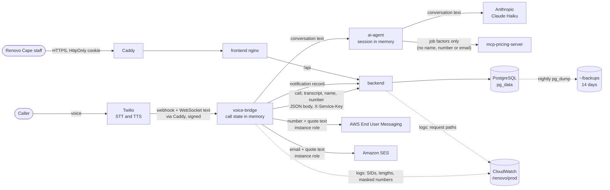

# Security and data design

This document covers what personal data Renovo holds, where that data goes,
how one business's data is kept apart, and how long it is kept. For what to do
when something goes wrong, see [incident-response.md](incident-response.md).

## 1. Roles under POPIA

- **Renovo Cape** is the *responsible party*. It is the business the caller
  phones, and it decides why the data is collected (to quote and call back).
- **The project team** is the *operator*. We run the system for Renovo Cape.
  POPIA section 21 expects a written agreement between the two. That agreement
  must require us to keep the data secure and to report any breach to Renovo
  Cape immediately. We do not have one yet.
- **Callers** are the *data subjects*.

## 2. Single-tenant isolation and safeguards

Renovo serves exactly one business. We isolate that business by deployment,
not by rows in shared tables:

- One EC2 instance, one Docker Compose stack (`docker-compose.prod.yml`, 7
  containers), one PostgreSQL database, one `.env`, one Twilio number and one
  pair of domains. All of it is for Renovo Cape only.
- No table has a `tenant_id` or `business_id` column, and no query filters by
  business. Every logged-in user, admin or staff, sees every lead, call and
  notification.
- A second business needs a **second stack**: its own instance (or Compose
  project), its own volumes, `.env`, secrets, domains, Twilio number and admin
  account. Never point a second business at this database. Making the code
  multi-tenant would need a tenant column on every table and a tenant check on
  every query. That is out of scope.

Put simply, there is nothing in the code that keeps two businesses apart. The
only wall between them is that they run on separate servers with separate
databases.

### Boundaries inside the one stack

| Boundary | How it is enforced |
|---|---|
| Internet to services | Only Caddy publishes ports (80, 443). `db`, `backend`, `ai-agent`, `mcp-pricing-server`, `voice-bridge` and `frontend` publish none and are reachable only on the Compose network |
| Admin access to the server | SSM Session Manager, controlled by IAM. Port 22 is closed |
| Database | PostgreSQL 16 (`db` service, `pg_data` volume). No published port. Only `backend` connects, with `POSTGRES_PASSWORD` from `.env`. Alembic runs the migrations (`backend/app/migrate.py`) each time the backend starts |
| Twilio to `voice-bridge` | In production every `/voice` webhook must carry a valid `X-Twilio-Signature` (HMAC-SHA1 with `TWILIO_AUTH_TOKEN`, compared in constant time). An unsigned or wrongly signed request gets 403. A WebSocket stream is accepted only for a call announced by a verified webhook. `voice-bridge` refuses to start in production without `TWILIO_AUTH_TOKEN`, and it ignores the dev-only switches `VALIDATE_TWILIO_SIGNATURE=false` and `ALLOW_UNVERIFIED_CALLS` (`voice-bridge/src/twilioSignature.js`) |
| `voice-bridge` to `backend` | Shared `SERVICE_API_KEY` in the `X-Service-Key` header, compared in constant time. The key can only create calls, leads and notifications and request quotes. Call, lead and notification data travel in typed JSON bodies (`backend/app/schemas.py`), never in the URL |
| Staff to dashboard | See "Sessions, roles and audit" below |
| `ai-agent`, `mcp-pricing-server` | No authentication of their own. They rely on being unreachable from outside |
| Browser to dashboard | Caddy adds HSTS, `X-Content-Type-Options`, `X-Frame-Options: DENY`, `Referrer-Policy`, `Permissions-Policy`, `Cross-Origin-Opener-Policy` and a Content-Security-Policy (`script-src 'self'`, no inline scripts, `frame-ancestors 'none'`) to every dashboard response (`deploy/Caddyfile`). The voice hostname gets the same basic headers. In production the backend hides `/docs`, `/redoc` and `/openapi.json` |

The Twilio signature check matters because the `/voice` URL is public. Twilio
signs each webhook with the account's auth token, and voice-bridge recomputes
that signature. Anyone else can find the URL, but they cannot produce a valid
signature without the token.

### Sessions, roles and audit

- **Accounts.** The first account to sign up becomes the admin. After that,
  sign-up is closed and only an admin can add accounts (`/users`, the Staff
  page). Passwords are hashed with bcrypt.
- **Roles.** `admin` or `staff`, enforced by a database check constraint
  (migration 0003). Staff work the leads and calls. Only an admin can manage
  accounts, change prices and read the audit log: `/users` and
  `/audit-events` refuse staff with 403. An admin cannot demote or deactivate
  their own account, so at least one admin can always log in.
- **Every request checks the account.** The backend loads the account from
  the database on each request (`backend/app/core/dependencies.py`). A
  deactivated account is refused at once, even with a token that has not
  expired, and a role change applies on the next request. The backend ignores
  the role claim in the token.
- **Session cookie.** Login sets a JWT (HS256, 60 minutes) in the
  `access_token` cookie. The cookie is `HttpOnly` and `SameSite=Strict`. It is
  also `Secure`, because `docker-compose.prod.yml` sets
  `ENVIRONMENT=production` (`backend/app/core/security.py`). Page scripts
  never see the token, and the dashboard keeps nothing about it in
  `localStorage`. The dashboard and API share one origin, so `SameSite=Strict`
  is the CSRF defence.

  In plain English, the browser holds the session but JavaScript on the page
  cannot read it, so an injected script cannot steal it. And because the
  browser only sends the cookie on requests that start from our own site,
  another website cannot make a logged-in user's browser act on their behalf.
- **Logout.** `POST /auth/logout` clears the cookie and records the event.
  It does not revoke the token itself: a copy taken before logout stays valid
  until it expires (see "Open risks").
- **Login rate limit.** 5 attempts a minute per client IP (slowapi). In
  production uvicorn runs with `--proxy-headers` and trusts
  `X-Forwarded-For` only from Docker's private ranges (`172.16.0.0/12`,
  `192.168.0.0/16`) (`backend/Dockerfile`, `backend/app/core/limiter.py`).
  This way the limit counts each real visitor, not Caddy's address. A
  forwarded header from anywhere else is ignored. A failed login gives the
  same answer for an unknown user, a wrong password and a deactivated account.

  Without this, every request would seem to come from Caddy, because Caddy
  is the one connecting to the backend. All visitors would then share one
  limit of 5 a minute. Trusting the header only from inside Docker also stops
  an attacker from sending a fake `X-Forwarded-For` to get a fresh limit.
- **Audit log.** `audit_events` (migration 0004) records logins (succeeded and
  failed), logouts, account creation, role changes, deactivation and
  reactivation, profile and password changes, price changes and lead
  deletions. Each event has the actor, time, client IP and target. The log is
  append-only at three levels: the ORM refuses updates and deletes,
  PostgreSQL triggers refuse `UPDATE` and `DELETE`, and the API has no
  endpoint that changes an event. Events never hold passwords, tokens, phone
  numbers, emails or transcripts. `backend/app/services/audit.py` rejects
  details with those keys. A failed login with an unknown username does not
  store the typed username.

  Append-only means rows can be added but never changed or removed. We block
  changes at three levels so that a bug or a misuse in one level cannot
  quietly rewrite the history.

### Monitoring

- Every container logs to CloudWatch Logs, group `/renovo/prod` in
  `eu-north-1`, kept for 14 days. The instance role can write to that group
  only.
- Metric filter `renovo-errors` counts error lines. Alarm `renovo-app-errors`
  fires on 1 or more in 5 minutes and emails the team through SNS topic
  `renovo-alerts`.
- `.github/workflows/uptime.yml` runs from GitHub every 10 minutes. It checks
  the dashboard and `/api/health`, and checks that `/voice` answers 403 to an
  unsigned request. GitHub emails on a failed run.

### Supply chain

- Python dependencies are fully pinned (`requirements.txt` compiled with
  `uv pip compile`). Node dependencies are locked in `package-lock.json`.
- CI (`.github/workflows/ci-cd.yml`, job `security-scan`) runs `npm audit
  --audit-level=high` for `frontend` and `voice-bridge`, and `pip-audit` for
  `backend`, `ai-agent` and `mcp-pricing-server`. CI also builds every Docker
  image.

### Open risks

| Risk | Why it matters | What would fix it |
|---|---|---|
| A token cannot be revoked before it expires | Logout clears the cookie, but a stolen token works for up to 60 minutes. Deactivating the account does stop it at once | A token ID in the JWT and a deny list checked on each request, or shorter tokens with refresh |
| Username enumeration through login timing | For an unknown username the backend skips the bcrypt check, so the answer comes back faster than for a real account with a wrong password. The message is the same | Check the password against a dummy hash when the user does not exist |
| Single server | The database, its nightly dumps and every service share one EC2 instance and one disk. The EBS snapshot restore was tested on 4 Nov 2026, but scheduled snapshots are not set up | Daily EBS snapshots with Data Lifecycle Manager; RDS later (only `DATABASE_URL` changes) |
| SMS and email in the AWS sandbox | Only verified numbers and addresses receive quotes. Real customers would not | Register an origination identity for South Africa and request SMS and SES production access |
| Gmail sender address | Email sent through SES from a Gmail address fails Gmail's DMARC check and may be rejected or marked as spam | Verify a domain Renovo Cape owns in SES, with SPF, DKIM and DMARC |
| No admin password reset | If the only admin forgets their password, nobody can reset it from the dashboard. It needs a database change on the server | A second admin account, and a reset flow or a server-side reset command |
| `ai-agent` and `mcp-pricing-server` trust their network | Anything that gets onto the Compose network can call them | A service key on both, like the backend's |

## 3. What personal data is stored

### Database (PostgreSQL, `pg_data` volume)

| Table | Personal fields | Notes |
|---|---|---|
| `call_logs` | `transcript` | The full conversation as text. It can hold anything the caller said: name, number, address, details about their home |
| | `call_sid` | Twilio's ID. Links to Twilio's own records of the caller's number |
| `leads` | `name`, `contact` | Caller's name (or "Unknown caller") and phone number: the mobile they gave, else the number they called from |
| | `suburb`, `job_details` (JSON text) | Suburb, plus job type, material, damage level, travel zone and quantity (also stored as their own columns) |
| | `quote`, `status` | Not personal on their own |
| `notifications` | `recipient`, `subject`, `message` | Phone number or email address, and the SMS or email text, which includes the caller's first name and quote |
| `admin_users` | `username`, `first_name`, `last_name`, `email`, `hashed_password`, `role`, `is_active` | Staff, not callers |
| `audit_events` | `actor_username`, `ip_address` | Staff usernames and the IP addresses they logged in from. No caller data |

The pricing rules (`pricing_config` volume) hold no personal data.

The SQLite file from before the move to PostgreSQL (`/data/renovo.db` in the
`backend_data` volume) is still on the server. It is mounted read-only into the
backend as a fallback. It holds the leads, calls and notifications up to
4 Nov 2026 and is no longer updated.

### Outside the database

| Where | What | How long |
|---|---|---|
| `voice-bridge` memory | Live transcript, caller's number, collected job details | Until the call ends and is saved; lost on restart |
| `ai-agent` memory | The conversation sent to Claude | Until `voice-bridge` ends the session; lost on restart |
| Container logs (CloudWatch `/renovo/prod`, plus Docker's local copy) | Call SIDs, message lengths, quote status, request paths. No transcripts, names or numbers: `voice-bridge` logs only lengths, and masks any number or email in provider errors (`redactPhones`, `redactEmails`, `maskPhone`, `maskEmail` in `voice-bridge/src/privacy.js`). `LOG_CALL_CONTENT=true` prints the conversation for local debugging and is ignored in production | 14 days in CloudWatch |
| Nightly dumps (`~/backups` on the server) | The whole database | 14 days (`deploy/backup.sh`) |
| Twilio | Call audio, caller's number, speech-to-text; text-to-speech (ElevenLabs voice) | Twilio's retention. The team owns the account; recording is off on the number |
| Anthropic | Conversation text, including name and number if said | Anthropic's API retention policy |
| AWS End User Messaging (SMS, `eu-north-1`) | Mobile number and SMS text | Provider's retention |
| Amazon SES (`eu-north-1`) | Email address and quote text, if the caller gives an email and `EMAIL_PROVIDER=ses` | Provider's retention |

`voice-bridge` sends SMS through AWS End User Messaging and email through
Amazon SES. The EC2 instance role authorises both, so no SMS or email keys are
stored in `.env`. Both services are in the AWS sandbox, so only verified
numbers and addresses receive messages. The code can also send SMS through
SMSPortal or Twilio (`SMS_PROVIDER`), but production uses AWS.

All of these providers, and our own server in Stockholm (`eu-north-1`), are
outside South Africa. POPIA section 72 allows this when the recipient is bound
by comparable protection or the data subject consents. Renovo Cape should name
these providers in its privacy notice.

## 4. Data flow

The pricing server receives only job factors (job type, material, damage
level, zone, quantity). `ai-agent` removes `caller_name`, `mobile_number` and
`email` before it calls the pricing server (`pricing_factors` in
`ai-agent/tools.py`).

## 5. Retention

**Leads, call logs and notifications are not deleted automatically.** They
are kept for as long as the database exists. These do expire:

- Container logs: 14 days in CloudWatch.
- Database dumps: `deploy/backup.sh` runs nightly and deletes dumps older
  than 14 days. So data deleted from the database is gone from the dumps
  after 14 days. The dumps share the server's disk, so a lost disk loses
  them too. Restoring the database from an EBS snapshot was tested on
  4 Nov 2026 (see `deploy/README.md`, "Backups"). Scheduled snapshots are not
  set up yet.

Deleting by hand:

- Staff can delete a lead from the dashboard. The call log it came from,
  including the transcript, is deleted with it, unless another lead still
  links to that call. The audit log records who deleted which lead ID, not
  the lead's details.
- The API has no way to delete a call log or a notification.
- By design, audit events cannot be deleted through the app or through the
  database user the app connects as. They hold staff data only.
- The old SQLite file in `backend_data` must be removed by hand once the
  PostgreSQL data is trusted.

Proposed retention, for Renovo Cape to agree:

| Data | Keep for | Then |
|---|---|---|
| Call transcripts | 90 days after the call | Clear `transcript`, keep the call row for statistics |
| Leads that became jobs | As long as Renovo Cape needs them for the job and its records | Delete or anonymise name and contact |
| Leads that did not become jobs | 12 months | Delete with their call log |
| Notifications | 12 months | Delete |
| Audit events | 12 months, to be agreed | Archive, then remove as the database owner |
| Container logs | 14 days | **Done:** CloudWatch retention on `/renovo/prod` |
| Database dumps | 14 days | **Done:** `deploy/backup.sh` |
| EBS snapshots, once scheduled | 7 to 30 days | Expire through Data Lifecycle Manager, so deletions take effect in backups too |

To make the rest real, we need a scheduled clean-up job for transcripts, leads
and notifications, and we need to remove the old SQLite file.

## 6. POPIA checklist

| Condition | Where we stand |
|---|---|
| Accountability | No operator agreement with Renovo Cape yet. Staff actions are recorded in the append-only audit log |
| Processing limitation (minimality) | The agent asks only for name, mobile number, suburb and job details (and an email address if the caller wants the quote emailed). Contact details are removed before the pricing server is called. But the full transcript is stored, and it can hold more |
| Purpose specification | Quote and call back. Retention limits for leads and transcripts are proposed, not built (section 5) |
| Further processing | Numbers must not be reused for marketing. The quote SMS and email are a reply to the caller's own request, not direct marketing (section 69) |
| Information quality | Staff can correct a lead's status, not its name or number |
| Openness (section 18) | **Partly met.** The greeting says the caller is speaking to an AI assistant and that the call is transcribed so the team can follow up. **Gap:** it does not say that overseas providers (Twilio, Anthropic, AWS) process the call details |
| Security safeguards (section 19) | Section 2 above: HTTPS with HSTS and a CSP, HttpOnly session cookie, roles checked on every request, per-IP login limit, signed Twilio webhooks, no caller data in logs or URLs, nightly backups with a tested snapshot restore, error alarms and uptime checks, dependency scans in CI. Gaps are listed under "Open risks" |
| Data subject participation | A caller can ask Renovo Cape for their data or for deletion. Today that needs a staff member for leads and the server operator for call logs and notifications |
| Transborder flows (section 72) | All processing is outside South Africa (section 3) |
| Breach notification (section 22) | incident-response.md section 8 |
