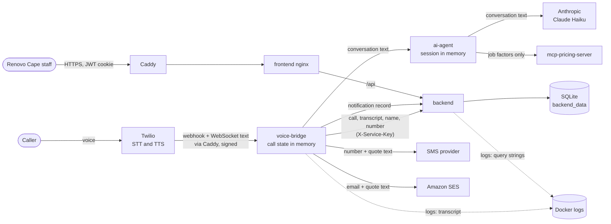

# Security and data design

What personal data Renovo holds, where it goes, how one business's data is
kept apart, and how long it is kept. For what to do when something goes wrong,
see [incident-response.md](incident-response.md).

## 1. Roles under POPIA

- **Renovo Cape** is the *responsible party*: the business the caller phones
  and the one that decides why the data is collected (to quote and call back).
- **The project team** is the *operator*: we run the system for Renovo Cape.
  POPIA section 21 expects a written agreement between the two that requires
  us to keep the data secure and to report any breach to Renovo Cape
  immediately. We do not have one yet.
- **Callers** are the *data subjects*.

## 2. Single-tenant isolation

Renovo serves exactly one business. Isolation is by deployment, not by rows:

- One EC2 instance, one Docker Compose stack, one SQLite database, one `.env`,
  one Twilio number and one pair of domains, all for Renovo Cape only.
- No table has a `tenant_id` or `business_id` column, and no query filters by
  business. Every logged-in user sees every lead, call and notification.
- Adding a second business means a **second stack**: its own instance (or
  Compose project), its own volumes, `.env`, secrets, domains, Twilio number
  and admin account. Never point a second business at this database. Making
  the code multi-tenant would need a tenant column on every table and a tenant
  check on every query, which is out of scope.

Inside the one stack:

| Boundary | How it is enforced |
|---|---|
| Internet to services | Only Caddy publishes ports (80, 443). `backend`, `ai-agent` and `mcp-pricing-server` are on the internal Docker network only |
| Admin access to the server | SSM Session Manager. Port 22 is closed |
| Twilio to `voice-bridge` | Every webhook must carry a valid `X-Twilio-Signature`. A WebSocket stream is accepted only for a call announced by a verified webhook |
| `voice-bridge` to `backend` | Shared `SERVICE_API_KEY` in the `X-Service-Key` header, compared in constant time. It can only create calls, leads and notifications and request quotes |
| Staff to dashboard | One admin account (`sysadmin`). Sign-up closes once the first account exists. JWT (HS256, 60 minutes by default) in an httpOnly cookie. Login limited to 5 attempts a minute. Passwords hashed with bcrypt |
| `ai-agent`, `mcp-pricing-server` | No authentication of their own. They rely on being unreachable from outside |

Known gaps (from the 2026-11-01 review):

- The cookie is not marked `secure`, because `ENVIRONMENT=production` is not
  set in `docker-compose.prod.yml`. Caddy serves HTTPS only, which limits the
  risk.
- The frontend still keeps the token in `localStorage` and sends it as a
  Bearer header, so the httpOnly cookie does not yet protect against XSS.
- Behind Caddy, the login rate limit sees every request as coming from one
  address, so all users share one limit.

## 3. What personal data is stored

### Database (`/data/renovo.db` in the `backend_data` volume)

| Table | Personal fields | Notes |
|---|---|---|
| `call_logs` | `transcript` | The full conversation as text. Can hold anything the caller said: name, number, address, details about their home |
| | `call_sid` | Twilio's ID. Links to Twilio's own records of the caller's number |
| `leads` | `name`, `contact` | Caller's name (or "Unknown caller") and phone number: the mobile they gave, else the number they called from |
| | `job_details` (JSON text) | Job type, material, damage level, travel zone, quantity, **suburb** |
| | `quote`, `status` | Not personal on their own |
| `notifications` | `recipient`, `message` | Phone number or email; the SMS text, which includes the caller's first name and quote |
| `admin_users` | `username`, `first_name`, `last_name`, `email`, `hashed_password` | Staff, not callers |

The pricing rules (`pricing_config` volume) hold no personal data.

### Outside the database

| Where | What | How long |
|---|---|---|
| `voice-bridge` memory | Live transcript, caller's number, collected job details | Until the call ends and is saved; lost on restart |
| `ai-agent` memory | The conversation sent to Claude | Until `voice-bridge` ends the session; lost on restart |
| `voice-bridge` container log | Every line said: `Caller said: ...`, `Agent said: ...`, the quote | Until the container is removed. No size or age limit is set |
| `backend` container log | `voice-bridge` sends name, contact and the whole transcript as URL query parameters, and Uvicorn logs the full URL of each request | Same as above |
| Twilio | Call audio, caller's number, speech-to-text; text-to-speech (ElevenLabs voice) | Twilio's retention. The account is not owned by the team |
| Anthropic | Conversation text, including name and number if said | Anthropic's API retention policy |
| SMS provider (SMSPortal or AWS End User Messaging) | Mobile number and SMS text | Provider's retention |
| Amazon SES (`eu-north-1`) | Email address and quote text, if the caller gives an email and `EMAIL_PROVIDER=ses` | Provider's retention |

All of these providers, and our own server in Stockholm (`eu-north-1`), are
outside South Africa. POPIA section 72 allows this when the recipient is bound
by comparable protection or the data subject consents. Renovo Cape should name
these providers in its privacy notice.

## 4. Data flow

The pricing server receives only job factors (job type, material, zone,
quantity), never the caller's name or number.

## 5. Retention

**Today nothing is deleted automatically.** Every lead, transcript and
notification is kept for as long as the database exists, and container logs
grow until the container is removed.

- Staff can delete a lead from the dashboard. The call log it came from,
  including the transcript, is **kept**.
- There is no way in the API to delete a call log or a notification.
- There are no backups (see incident-response.md section 9), so deleted data
  is gone, and a lost disk loses everything.

Proposed retention, for Renovo Cape to agree:

| Data | Keep for | Then |
|---|---|---|
| Call transcripts | 90 days after the call | Clear `transcript`, keep the call row for statistics |
| Leads that became jobs | As long as Renovo Cape needs them for the job and its records | Delete or anonymise name and contact |
| Leads that did not become jobs | 12 months | Delete with their call log |
| Notifications | 12 months | Delete |
| Container logs | 14 days, capped in size | Rotated by Docker (`logging: options: max-size, max-file`) |
| Backups, once they exist | 7 to 30 days | Expire through Data Lifecycle Manager, so deletions take effect in backups too |

Making this real needs: a scheduled clean-up job, deleting the call log when
its lead is deleted, log rotation in `docker-compose.prod.yml`, and sending
call data in the request body instead of the URL so transcripts stop reaching
the access log.

## 6. POPIA checklist

| Condition | Where we stand |
|---|---|
| Accountability | No operator agreement with Renovo Cape yet |
| Processing limitation (minimality) | The agent asks only for name, mobile number, suburb and job details. But the full transcript is stored, and it can hold more |
| Purpose specification | Quote and call back. Retention limits are proposed, not built (section 5) |
| Further processing | Numbers must not be reused for marketing. The quote SMS is a reply to the caller's own request, not direct marketing (section 69) |
| Information quality | Staff can correct a lead's status, not its name or number |
| Openness (section 18) | **Partly met.** The greeting says the caller is speaking to an AI assistant and that the call is transcribed so the team can follow up. **Gap:** it does not say that call details are processed by overseas providers (Twilio, Anthropic) |
| Security safeguards (section 19) | Section 2 above. Gaps: no backups, EBS volume encryption not confirmed, personal data in logs, no monitoring |
| Data subject participation | A caller can ask Renovo Cape for their data or for deletion. Today that needs a staff member for leads and the server operator for call logs |
| Transborder flows (section 72) | All processing is outside South Africa (section 3) |
| Breach notification (section 22) | incident-response.md section 8 |
